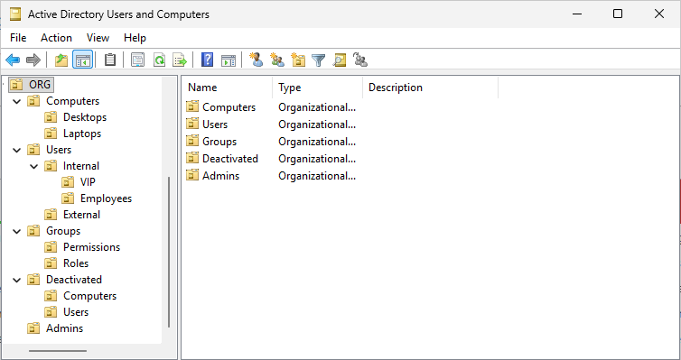

# HomeLab Support IT

Reproduction virtualisée de l'infrastructure informatique d'une PME, pour pratiquer le support informatique de niveau 1 et 2 : gestion des utilisateurs, postes de travail, droits d'accès et traitement des incidents.

> Projet en cours, démarré en octobre 2026.

## Environnement

- **Hôte** : PC personnel sous Windows, 32 Go de RAM
- **Hyperviseur** : Oracle VirtualBox
- **Réseau** : réseau virtuel isolé, sans impact sur le réseau domestique

### Machines virtuelles prévues

| VM | Système | Rôle | RAM |
| --- | --- | --- | --- |
| SRV-DC01 | Windows Server 2025 | Contrôleur de domaine : Active Directory, DNS, DHCP | 4 Go |
| PC-CLIENT01 | Windows 11 Entreprise | Poste de travail d'un employé | 4 Go |

## Feuille de route

### Phase 1 : fondations
- [x] Création du dépôt et de la structure de documentation
- [x] Téléchargement des images d'installation (Windows Server 2025, Windows 11 Entreprise)
- [x] Préparation de l'hôte et installation de VirtualBox
- [x] Installation de Windows Server et promotion en contrôleur de domaine
- [x] Configuration DNS et DHCP
- [x] Installation d'un poste client Windows 11 joint au domaine

### Phase 2 : support au quotidien
- [x] Gestion des comptes utilisateurs et des groupes Active Directory
- [x] Partages de fichiers et droits NTFS
- [ ] Stratégies de groupe (GPO)
- [ ] Traitement de tickets dans ServiceNow (instance développeur), selon les pratiques ITIL
- [ ] Prise en main à distance
- [ ] Administration du domaine depuis le poste client (outils RSAT)
- [ ] Chiffrement BitLocker avec sauvegarde des clés de récupération dans Active Directory
- [ ] Sauvegarde et restauration

### Phase 3 : approfondissement
- [ ] Automatisation avec PowerShell
- [ ] Déploiement d'un second contrôleur de domaine en Server Core, administré à distance
- [ ] Pare-feu / routeur virtuel (pfSense)

## Compétences mises en œuvre

- Déploiement d'un domaine Active Directory (nouvelle forêt, contrôleur de domaine Windows Server 2025)
- Configuration DNS : redirecteurs, zone de recherche inversée, enregistrements dynamiques sécurisés
- Configuration DHCP : étendue, options, autorisation dans Active Directory
- Mise en service d'un poste Windows 11 et jonction au domaine
- Diagnostic d'incidents : relation d'approbation poste/domaine, enregistrements DNS obsolètes
- Structuration d'un annuaire Active Directory : unités d'organisation, conventions de nommage, groupes de rôle
- Gestion du cycle de vie des comptes : création, réinitialisation, déverrouillage, arrivée et départ d'un employé
- Configuration d'une stratégie de verrouillage des comptes par GPO
- Rédaction de tickets de support selon les pratiques ITIL (incident, demande de service, priorité)
- Partages de fichiers et droits NTFS selon la méthode AGDLP, appartenance temporaire aux groupes (Privileged Access Management)

## Organisation du dépôt

| Dossier | Contenu |
| --- | --- |
| [`journal/`](journal/) | Notes de chaque séance de travail, datées |
| [`procedures/`](procedures/) | Fiches techniques réutilisables (ex. : créer un utilisateur) |
| [`incidents/`](incidents/) | Pannes réelles rencontrées sur le lab : symptôme, diagnostic, résolution |
| [`tickets/`](tickets/) | Demandes d'utilisateurs simulées, traitées comme dans un outil de ticketing |
| [`scripts/`](scripts/) | Scripts d'automatisation |

### Organisation de l'annuaire

## Note de sécurité

Aucun mot de passe ni identifiant réel n'est publié dans ce dépôt. Les adresses IP mentionnées appartiennent au réseau privé du lab.
