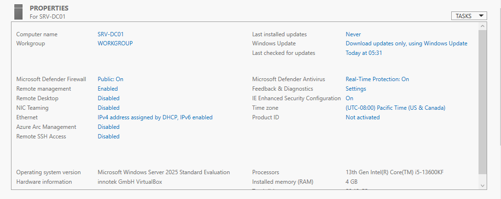

# INC-001 — Fuseau horaire incorrect sur SRV-DC01

| Champ | Valeur |
| --- | --- |
| Date | 9 octobre 2026 |
| Catégorie | Système / Prévention |
| Machine | SRV-DC01 |
| Statut | Résolu |

## Symptôme

Lors de la relecture des captures d'écran, le Gestionnaire de serveur affichait le fuseau horaire **(UTC-08:00) Pacific Time (US & Canada)**, valeur par défaut de l'image d'installation en anglais.

## Risque identifié

Aucune panne constatée, mais un risque important pour la suite :

- Active Directory utilise le protocole **Kerberos** pour l'authentification.
- Kerberos refuse l'authentification si l'horloge d'un poste et celle du contrôleur de domaine ont plus de **5 minutes d'écart**.
- Le contrôleur de domaine sert de référence horaire à tout le domaine : une erreur à ce niveau se propagerait à tous les postes.

## Résolution

Dans le Gestionnaire de serveur → Serveur local, modification du fuseau horaire en **(UTC+01:00) Brussels, Copenhagen, Madrid, Paris**, avant la promotion en contrôleur de domaine.

## Vérification

Le fuseau horaire affiché est correct et l'heure de SRV-DC01 correspond à celle de l'hôte.

## Leçon retenue

Vérifier systématiquement le fuseau horaire et l'heure d'un serveur juste après son installation, en particulier pour un futur contrôleur de domaine.
