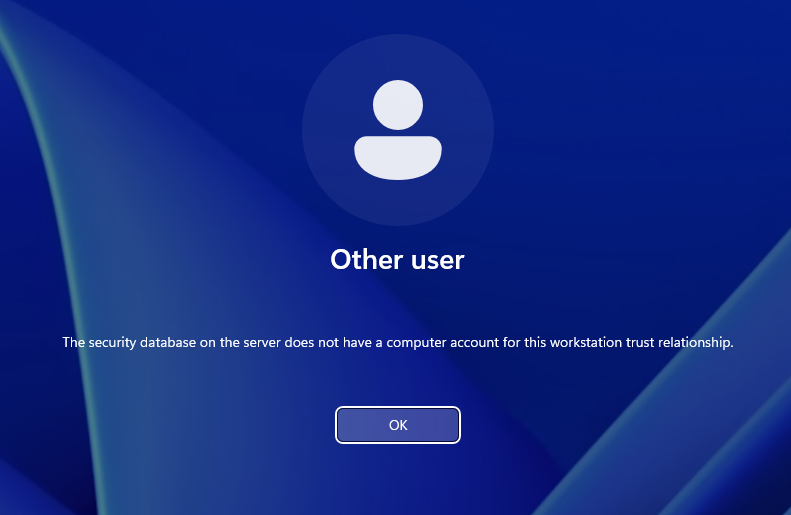
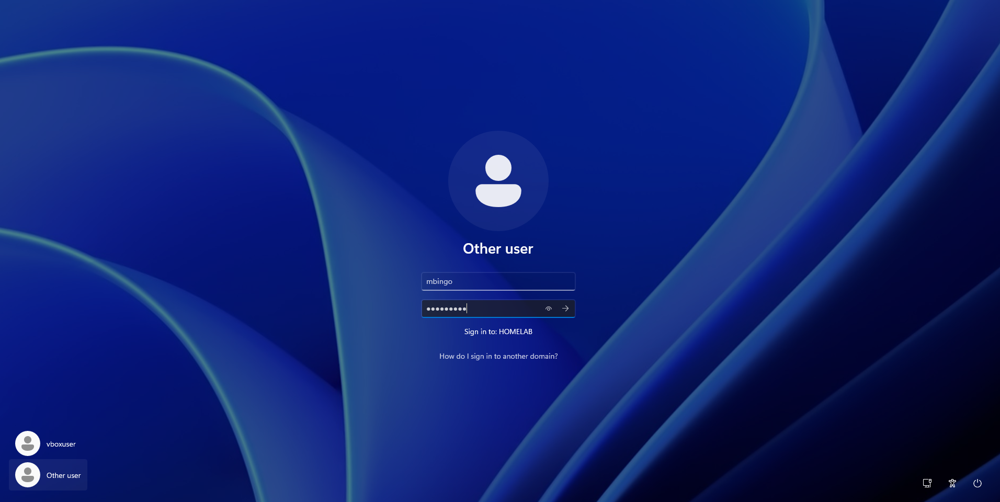

# INC-003 — Ouverture de session impossible : compte ordinateur introuvable

| Champ | Valeur |
| --- | --- |
| Date | 15 octobre 2026 |
| Catégorie | Active Directory / Postes de travail |
| Machine | PC-CLIENT01 (première installation) |
| Statut | Résolu par réinstallation du poste |

## Symptôme

Après la jonction au domaine, impossible d'ouvrir une session sur le poste avec l'utilisateur du domaine `mbingo`. Message affiché :

> The security database on the server does not have a computer account for this workstation trust relationship.



## Analyse

Le message ne concerne pas l'utilisateur mais **l'ordinateur**. Avant de vérifier le mot de passe de l'utilisateur, le poste s'authentifie auprès du contrôleur de domaine avec son propre compte ordinateur. Le contrôleur ne trouve pas de compte correspondant : la relation d'approbation entre le poste et le domaine est rompue.

Causes possibles envisagées :

1. Nom du poste différent de celui de l'objet ordinateur dans AD
2. Objet ordinateur supprimé ou modifié dans AD
3. Snapshot restauré après la jonction (mot de passe machine désynchronisé)

## Diagnostic

- Vérifications prévues : nom réel du poste (`hostname`), test du lien avec `Test-ComputerSecureChannel -Verbose`, comparaison avec l'objet présent dans AD.
- **Blocage** : impossible de se connecter avec le compte local du poste. Ce compte (`vboxuser`) avait été créé automatiquement par l'installation sans surveillance de VirtualBox, et son mot de passe n'avait pas été noté.

## Cause

L'objet ordinateur avait été pré-créé dans AD sous le nom `PC-USER01`, alors que le poste s'appelait `PC-CLIENT01`. Le poste ne retrouvait donc pas son compte ordinateur.

## Résolution

Le poste étant un poste de test sans données, la réinstallation complète était plus rapide qu'une réparation.

1. Suppression de la VM et réinstallation de Windows 11
2. Pré-création de l'objet ordinateur avec le nom exact `PC-CLIENT01`
3. Nouvelle jonction au domaine

## Vérification

Ouverture de session réussie avec `HOMELAB\mbingo`.



## Leçons retenues

- Un objet ordinateur pré-créé doit porter **exactement** le nom d'hôte du poste. Vérifier avec `hostname` avant la jonction.
- Toujours conserver un **accès de secours** à un poste (compte local avec un mot de passe connu). En entreprise, des solutions comme **LAPS** gèrent un mot de passe administrateur local unique par poste, stocké dans AD.
- Après une réinstallation, vérifier les traces laissées par l'ancienne machine (voir INC-004).

## Résolution complémentaire

Modification du mot de passe utilisateur de "vboxuser", depuis PowerShell ouvert en mode Administrateur, avec la commande suivante

```
net user vboxuser *
```
