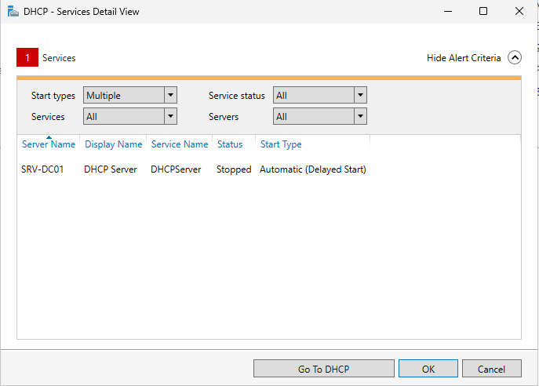

# INC-005 — Serveur DHCP arrêté au démarrage : échec d'autorisation dans Active Directory

| Champ | Valeur |
| --- | --- |
| Date | 26 octobre 2026 (prévention vérifiée le 27 octobre) |
| Catégorie | Réseau / DHCP / Active Directory |
| Machine | SRV-DC01, PC-CLIENT01 |
| Statut | Résolu |

## Symptôme

Lors de la préparation d'un scénario, le compte d'Alice Martin devait être verrouillé par des saisies de mot de passe incorrectes sur PC-CLIENT01. Le verrouillage ne se produisait pas :
- l'écran de connexion refusait les mauvais mots de passe avec le message « Invalid credentials, delaying next attempt » ;
- le bon mot de passe ouvrait la session normalement ;
- sur SRV-DC01, le compte n'avait enregistré aucun échec :

```
badPwdCount       : 0
LockedOut         : False
lockoutTime       : 0
```

Les tentatives n'atteignaient donc pas le contrôleur de domaine.

## Analyse

### Côté poste

```
C:\Users\amartin>echo %LOGONSERVER%
\\SRV-DC01

C:\Users\amartin>nltest /sc_query:homelab.internal
Trusted DC Connection Status Status = 1311 0x51f ERROR_NO_LOGON_SERVERS
```

- `ERROR_NO_LOGON_SERVERS` : le poste ne trouve aucun contrôleur de domaine.
- `%LOGONSERVER%` affichait pourtant `\\SRV-DC01` : la variable peut reprendre le serveur d'une connexion précédente et ne prouve pas que le poste joint le domaine.
- La session d'Alice avait été ouverte avec les **identifiants mis en cache** : le poste validait lui-même les mots de passe, sans interroger le contrôleur de domaine.

```
Autoconfiguration IPv4 Address. . : 169.254.52.208(Preferred)
```

```
C:\Users\amartin>ipconfig /renew
An error occurred while renewing interface Ethernet : unable to contact your DHCP server. Request has timed out.
```

Adresse **APIPA** (169.254.x.x) : Windows se l'attribue seul quand aucun serveur DHCP ne répond. Sans adresse dans `192.168.100.0/24` ni serveur DNS, le poste ne peut pas localiser le domaine.

### Côté serveur, par élimination

| Vérification | Résultat | Conclusion |
| --- | --- | --- |
| `ipconfig` | `192.168.100.10` | Adresse du serveur correcte |
| `Get-Service DHCPServer` | `Running` | Service démarré |
| `Get-DhcpServerv4Scope` | Étendue `LabNet` `Active`, 100 adresses libres | Étendue disponible |
| Adresse fixe temporaire sur le poste, `ping 192.168.100.10` | 4 réponses sur 4 | Le réseau entre les deux VM fonctionne |
| `Get-DhcpServerv4Binding` | `Ethernet`, `192.168.100.10`, `True` | Service lié à la bonne carte |
| `Get-DhcpServerInDC` | `192.168.100.10 srv-dc01.homelab.internal` | Serveur autorisé dans Active Directory |
| Règles de pare-feu *DHCP Server* | Activées, entrantes, *Allow* | Pare-feu non bloquant |

Tout était conforme. Le journal du service DHCP (`C:\Windows\System32\dhcp\DhcpSrvLog-Mon.log`) donnait la cause :

```
00,10/26/26,13:08:26,Started
50,10/26/26,13:08:37,Unreachable Domain,,homelab.internal
56,10/26/26,13:08:37,Authorization failure, stopped servicing,,homelab.internal
00,10/26/26,13:26:09,Started
50,10/26/26,13:26:20,Unreachable Domain,,homelab.internal
56,10/26/26,13:26:20,Authorization failure, stopped servicing,,homelab.internal
```

## Cause

Au démarrage, le service DHCP vérifie dans Active Directory qu'il est autorisé à distribuer des adresses : c'est la protection contre les serveurs DHCP non autorisés (*rogue DHCP*). Onze secondes après son lancement, il n'a pas pu joindre le domaine et a **cessé de distribuer des adresses**, tout en restant à l'état *Running*.

Sur un contrôleur de domaine, le service DHCP démarre en même temps qu'Active Directory et le DNS : sa vérification a eu lieu avant que l'annuaire soit prêt. Le problème s'est reproduit aux deux redémarrages de la journée (13:08 et 13:26). Une fois le serveur démarré, l'autorisation était bien trouvée (`Get-DhcpServerInDC`).

## Impact

- Aucun poste ne pouvait obtenir d'adresse.
- Les postes déjà connectés au domaine continuaient de fonctionner en apparence : ouverture de session par identifiants en cache, GPO conservées localement. Mais sans aucun contrôle du domaine : ni verrouillage de compte, ni prise en compte d'un compte désactivé ou d'un mot de passe changé.

## Résolution

1. Redémarrage du service, une fois le contrôleur de domaine pleinement démarré :

```powershell
Restart-Service DHCPServer
```

```
01,10/26/26,14:07:32,Stopped
00,10/26/26,14:07:35,Started
55,10/26/26,14:07:35,Authorized(servicing),,homelab.internal
```

2. Prévention : démarrage différé du service, environ deux minutes après le démarrage de Windows :

```powershell
sc.exe config DHCPServer start= delayed-auto
```

Dans PowerShell, `sc` est un alias de `Set-Content` : il faut taper `sc.exe`.

## Vérification

Sur PC-CLIENT01 :

```
C:\Users\Administrator> ipconfig /renew
   IPv4 Address. . . . . . . . . . . : 192.168.100.101

C:\Users\Administrator> nltest /sc_query:homelab.internal
Trusted DC Name \\SRV-DC01.homelab.internal
Trusted DC Connection Status Status = 0 0x0 NERR_Success
```

Au redémarrage suivant de SRV-DC01, le 27/10, le tableau de bord du *Server Manager* affichait le service arrêté avant son lancement différé :



Le journal confirme le démarrage différé et l'autorisation dès la première vérification, sans échec :

```
00,10/27/26,13:08:32,Started
55,10/27/26,13:08:32,Authorized(servicing),,homelab.internal
```

## Leçons retenues

- **Un service *Running* n'est pas un service qui fonctionne.** Le journal propre au service dit ce qu'il fait réellement.
- **Une adresse en 169.254.x.x signifie qu'aucun serveur DHCP n'a répondu.**
- **Un poste qui « fonctionne » n'est pas forcément connecté au domaine** : les identifiants en cache et les GPO conservées localement masquent la coupure. `nltest /sc_query:<domaine>` est plus fiable que `%LOGONSERVER%`.
- **Diagnostiquer par élimination**, en séparant les couches : adresse du serveur, service, étendue, réseau (test avec adresse fixe), liaison, autorisation, pare-feu, puis journal du service.
- Sur un contrôleur de domaine, les services qui dépendent d'Active Directory peuvent échouer s'ils démarrent avant l'annuaire : le démarrage différé est une correction simple.
