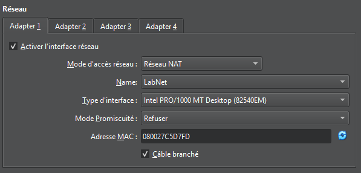
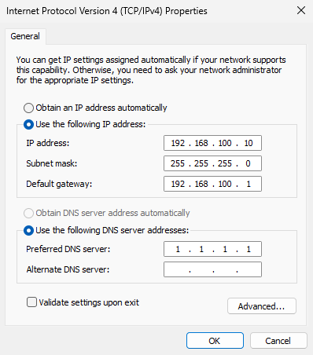
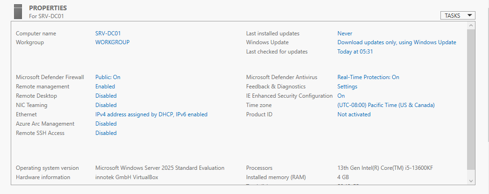

# Journal — 9 octobre 2026

## Objectif de la séance

Préparer l'environnement de virtualisation et installer le premier serveur du lab, SRV-DC01, futur contrôleur de domaine.

## Réalisé

- Installation de VirtualBox sur l'hôte et téléchargement des ISO (Windows Server 2025, Windows 11 Entreprise)
- Création du réseau virtuel du lab **LabNet** (Réseau NAT, `192.168.100.0/24`, DHCP de VirtualBox désactivé)
- Création de la VM **SRV-DC01** : 4 Go de RAM, 2 vCPU, disque dynamique de 60 Go, carte réseau sur LabNet
- Installation de Windows Server 2025 Standard Evaluation (expérience de bureau)
- Installation des additions invitées VirtualBox et activation du presse-papier partagé
- Renommage du serveur en `SRV-DC01`
- Configuration d'une adresse IP statique
- Correction du fuseau horaire

## Plan d'adressage du lab

| Adresse | Usage |
| --- | --- |
| 192.168.100.1 | Passerelle (VirtualBox) |
| 192.168.100.10 | SRV-DC01 |
| 192.168.100.11 | Réservée : SRV-DC02 |
| 192.168.100.20 | Réservée : SRV-GLPI |
| 192.168.100.100 à .200 | Plage DHCP des postes clients |

Configuration IPv4 de SRV-DC01 :

- Adresse : `192.168.100.10` / `255.255.255.0`
- Passerelle : `192.168.100.1`
- DNS : `1.1.1.1` (temporaire, en attendant que le serveur devienne son propre serveur DNS avec Active Directory)

## Choix techniques

- **Plage `192.168.100.0/24`** : plage privée, choisie pour ne pas entrer en conflit avec le réseau domestique (les box utilisent généralement `192.168.0.x` ou `192.168.1.x`).
- **DHCP de VirtualBox désactivé** : SRV-DC01 sera le serveur DHCP du lab. Deux serveurs DHCP sur le même réseau distribueraient des configurations incohérentes.
- **Renommage avant la promotion en contrôleur de domaine** : renommer un contrôleur de domaine après coup est une opération délicate.

## Incidents traités

| Ticket | Résumé |
| --- | --- |
| [INC-001](../incidents/INC-001_fuseau-horaire-srv-dc01.md) | Fuseau horaire incorrect sur SRV-DC01 |

## Tests de connectivité

C:\>ipconfig

Windows IP Configuration
Ethernet adapter Ethernet:

   Connection-specific DNS Suffix  . :
   Link-local IPv6 Address . . . . . : fe80::4c0b:321f:da36:496%5
   IPv4 Address. . . . . . . . . . . : 192.168.100.10
   Subnet Mask . . . . . . . . . . . : 255.255.255.0
   Default Gateway . . . . . . . . . : 192.168.100.1

C:\>ping 192.168.100.1

Pinging 192.168.100.1 with 32 bytes of data:
Reply from 192.168.100.1: bytes=32 time<1ms TTL=255

Ping statistics for 192.168.100.1:
    Packets: Sent = 1, Received = 1, Lost = 0 (0% loss)

## Sauvegarde

| Nom | État de la VM | Usage |
| --- | --- | --- |
| Installation de base - avant AD | Windows Server installé, renommé, IP fixe, fuseau horaire corrigé, additions invitées installées. Aucun rôle installé, mises à jour non appliquées. | Point de retour si la promotion en contrôleur de domaine échoue |

## Prochaine étape

Installation du rôle AD DS et promotion de SRV-DC01 en contrôleur de domaine.
