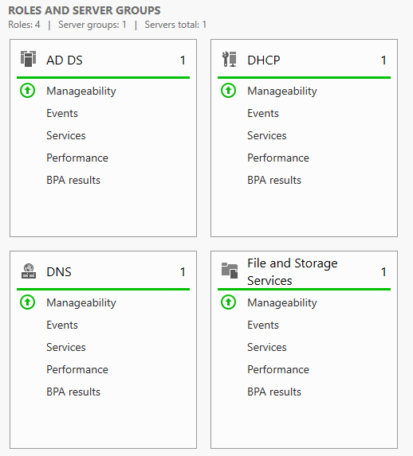
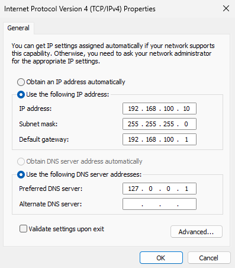
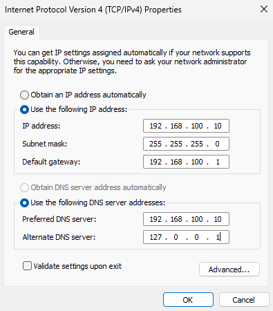
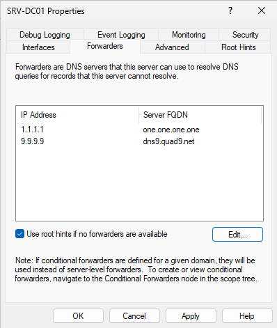
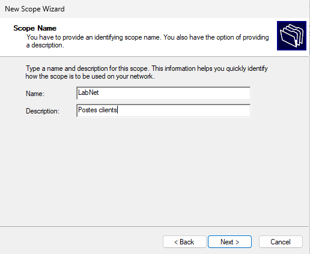
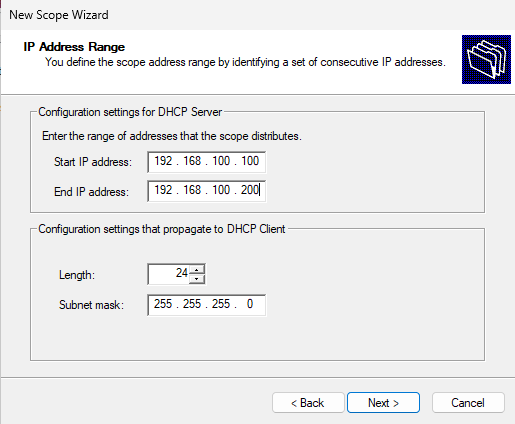
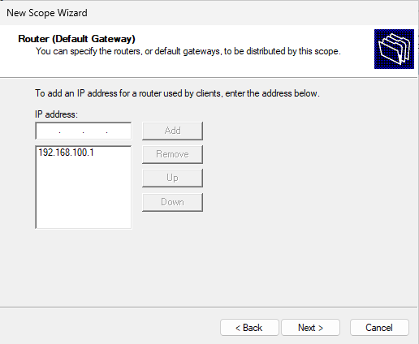

# Journal — 13 octobre 2026

## Objectif de la séance

Installer Active Directory, promouvoir SRV-DC01 en premier contrôleur de domaine du lab, finaliser la configuration DNS et installer le serveur DHCP.

## Réalisé

- Snapshot de SRV-DC01 avant intervention : « Installation de base - avant AD »
- Installation du rôle **AD DS** et promotion de SRV-DC01 en contrôleur de domaine, avec création d'une nouvelle forêt **`homelab.internal`**
- Snapshot après intervention : « AD DS installé - homelab.internal »
- Correction des serveurs DNS de la carte réseau
- Configuration des redirecteurs DNS vers internet
- Création de la zone de recherche inversée et de l'enregistrement PTR du serveur
- Installation du rôle **DHCP** et création de l'étendue des postes clients



## Partie 1 : Active Directory

### Paramètres de la promotion

| Paramètre | Valeur choisie | Justification |
| --- | --- | --- |
| Type de déploiement | Nouvelle forêt | Premier contrôleur de domaine du lab |
| Nom de domaine | `homelab.internal` | Suffixe réservé aux réseaux privés. `.local` est déconseillé (conflit avec mDNS) |
| Niveaux fonctionnels | Par défaut (Windows Server 2025) | Tous les contrôleurs du lab seront sous Windows Server 2025 |
| Serveur DNS | Activé | Les postes trouvent le contrôleur de domaine grâce au DNS |
| Catalogue global | Activé | Obligatoire pour le premier contrôleur d'une forêt |
| Mot de passe DSRM | Défini, conservé hors du dépôt | Accès de secours pour réparer ou restaurer l'annuaire |
| Nom NetBIOS | `HOMELAB` | Nom court du domaine, utilisé dans le format `HOMELAB\utilisateur` |
| Chemins NTDS et SYSVOL | Par défaut | Pas de besoin de performances justifiant un disque dédié |

L'avertissement sur la délégation DNS a été ignoré : il est normal pour un domaine qui n'a pas vocation à être visible sur internet.

### Vérifications

```
PS C:\> Get-ADDomain | Select-Object DNSRoot, NetBIOSName, DomainMode, PDCEmulator

DNSRoot          NetBIOSName DomainMode        PDCEmulator
-------          ----------- ----------        -----------
homelab.internal HOMELAB     Windows2025Domain SRV-DC01.homelab.internal

PS C:\> Get-ADForest | Select-Object Name, ForestMode, GlobalCatalogs

Name             ForestMode        GlobalCatalogs
----             ----------        --------------
homelab.internal Windows2025Forest {SRV-DC01.homelab.internal}

C:\> whoami
homelab\administrator
```

| Test | Attendu | Résultat |
| --- | --- | --- |
| Écran de connexion | `HOMELAB\Administrator` | OK |
| Commande `whoami` | `homelab\administrator` | OK |
| Rôles AD DS et DNS dans le Gestionnaire de serveur | Présents | OK |
| Console Active Directory Users and Computers | Domaine `homelab.internal` visible | OK |
| Zone DNS `homelab.internal` | Créée, avec les enregistrements d'Active Directory | OK |

## Partie 2 : configuration DNS

### Serveurs DNS de la carte réseau

| | Préféré | Auxiliaire |
| --- | --- | --- |
| Après la promotion (réglage automatique) | `127.0.0.1` | aucun |
| Après correction | `192.168.100.10` | `127.0.0.1` |

L'adresse réelle du serveur est placée en premier, conformément aux recommandations de Microsoft. Aucun DNS public n'est configuré sur la carte : dans un domaine, les machines n'interrogent que les DNS internes.





### Redirecteurs

Les requêtes pour des noms extérieurs au domaine sont transmises à deux DNS publics :

| Adresse | Serveur |
| --- | --- |
| `1.1.1.1` | Cloudflare (`one.one.one.one`) |
| `9.9.9.9` | Quad9 (`dns9.quad9.net`), en secours |

L'option « Use root hints if no forwarders are available » est conservée : si les deux redirecteurs sont injoignables, le serveur interroge directement les serveurs racine d'internet.



### Zone de recherche inversée

| Paramètre | Valeur |
| --- | --- |
| Nom de la zone | `100.168.192.in-addr.arpa` |
| Type | Principale, intégrée à Active Directory |
| Réplication | Tous les serveurs DNS des contrôleurs du domaine |
| Mises à jour dynamiques | Sécurisées uniquement |

Enregistrement PTR créé pour `192.168.100.10` → `srv-dc01.homelab.internal`.

### Tests

| Test | Commande | Résultat |
| --- | --- | --- |
| Nom → IP | `nslookup srv-dc01.homelab.internal` | OK : `192.168.100.10` |
| IP → nom | `nslookup 192.168.100.10` | OK : `SRV-DC01.homelab.internal` |
| Nom extérieur | `nslookup google.fr` | OK, via le redirecteur |
| Accès internet | `ping google.fr` | [À COMPLÉTER] |

```
PS C:\> nslookup srv-dc01.homelab.internal
Server:  UnKnown
Address:  ::1

Name:    srv-dc01.homelab.internal
Address:  192.168.100.10

PS C:\> nslookup 192.168.100.10
Server:  UnKnown
Address:  ::1

Name:    SRV-DC01.homelab.internal
Address:  192.168.100.10

PS C:\> nslookup google.fr
Server:  UnKnown
Address:  ::1

Non-authoritative answer:
Name:    google.fr
Addresses:  2a00:1450:4001:c17::5e
          142.251.14.9
```

- **« Server: UnKnown »** : `nslookup` interroge le DNS via l'adresse de bouclage IPv6 `::1`, pour laquelle il n'existe pas de nom. Message sans conséquence.
- **« Non-authoritative answer »** : SRV-DC01 n'est pas le serveur officiel de `google.fr`. La réponse a été obtenue par le redirecteur, ce qui confirme son bon fonctionnement.

## Partie 3 : serveur DHCP

Rôle DHCP installé, puis autorisé dans Active Directory : un serveur DHCP Windows non autorisé dans le domaine refuse de distribuer des adresses.

### Étendue

| Paramètre | Valeur |
| --- | --- |
| Nom | `LabNet` (description : « Postes clients ») |
| Plage | `192.168.100.100` à `192.168.100.200` |
| Masque | `255.255.255.0` (/24) |
| Exclusions | Aucune |
| Passerelle (option Router) | `192.168.100.1` |
| Domaine et DNS | [`homelab.internal`, DNS `192.168.100.10` uniquement] |
| Durée du bail | [ 8 jours] |
| État | [étendue activée] |

Les adresses fixes (`.1` à `.99`) restent en dehors de la plage, réservées à la passerelle et aux serveurs.







L'étendue sera testée lors de la première connexion du poste client.

## Notions clés

- **Active Directory** : annuaire centralisé des utilisateurs, ordinateurs et groupes du réseau.
- **AD DS** : le rôle Windows Server qui fait fonctionner l'annuaire. Un serveur qui l'héberge est un contrôleur de domaine.
- **LDAP** : le protocole pour interroger et modifier l'annuaire.
- **Kerberos** : le protocole d'authentification, basé sur des tickets horodatés. Le mot de passe ne circule pas sur le réseau, et un écart d'horloge de plus de 5 minutes bloque l'authentification.
- **DNS** : traduit les noms en adresses IP et permet aux postes de trouver le contrôleur de domaine. Sans DNS fonctionnel, pas d'Active Directory.
- **Redirecteur DNS** : serveur auquel le DNS interne transmet les requêtes qu'il ne sait pas résoudre lui-même.
- **Zone inversée et enregistrement PTR** : permettent de retrouver un nom à partir d'une adresse IP.
- **Forêt et domaine** : le domaine est l'unité de gestion, la forêt est l'ensemble des domaines d'une organisation et constitue la frontière de sécurité. Ici, une forêt contenant un seul domaine.
- **DHCP et DORA** : attribution automatique de la configuration réseau en quatre échanges : Discover, Offer, Request, Acknowledge.

## Problèmes rencontrés

| Ticket | Résumé |
| --- | --- |
| [INC-002](../incidents/INC-002_zone-inversee-dns.md) | Recherche DNS inversée en échec : zone créée au mauvais endroit |

## Prochaine étape

Installation du poste client PC-CLIENT01 et jonction au domaine
