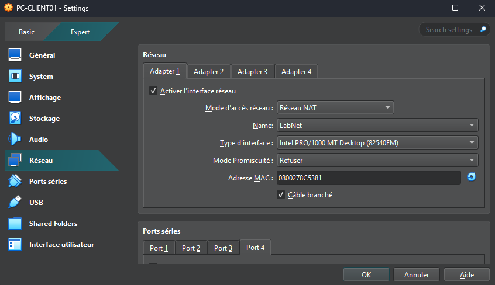
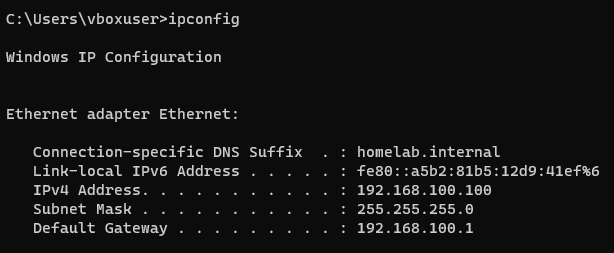
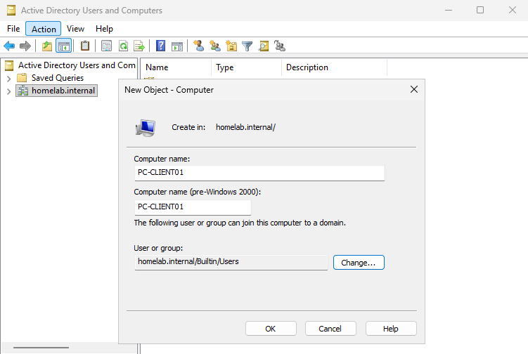
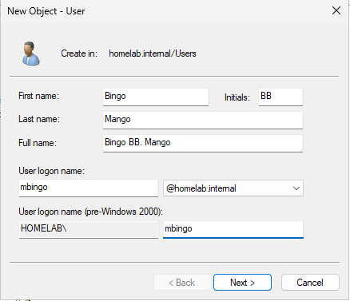
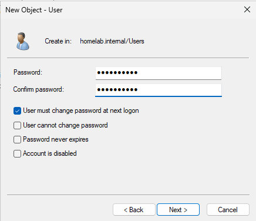
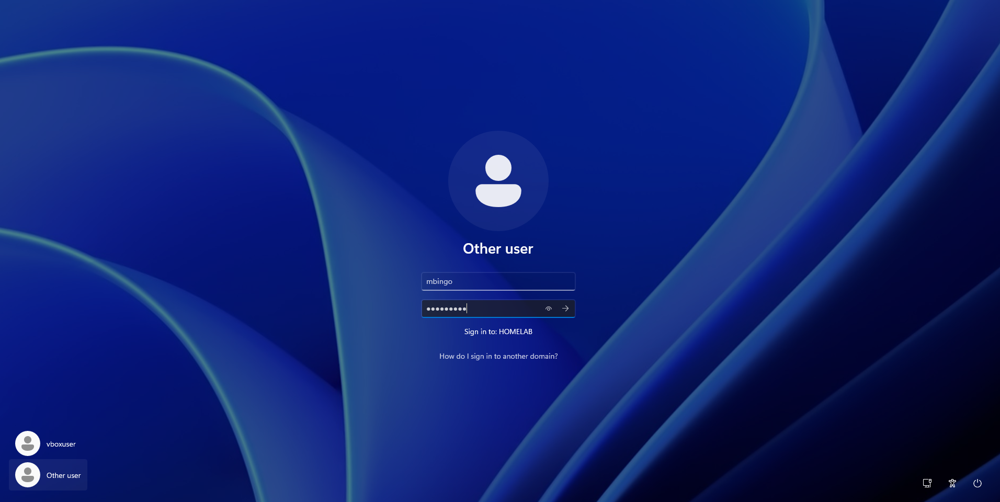

# Journal — 15 octobre 2026

## Objectif de la séance

Mettre en service le poste d'un nouvel employé : installer PC-CLIENT01, le joindre au domaine `homelab.internal` et ouvrir une session avec un compte utilisateur du domaine.

## Réalisé

- Création de la VM PC-CLIENT01 (Windows 11 Entreprise)
- Configuration réseau automatique par le serveur DHCP
- Pré-création de l'objet ordinateur dans Active Directory
- Jonction du poste au domaine
- Création du premier compte utilisateur du domaine
- Ouverture de session avec ce compte sur le poste
- Diagnostic et résolution de deux incidents (voir plus bas)

## Création de la VM

| Ressource | Valeur | Justification |
| --- | --- | --- |
| RAM | 4 Go | Minimum requis par Windows 11 |
| Processeurs | 2 | Minimum requis par Windows 11 |
| Disque | 64 Go | En dessous, l'installation de Windows 11 refuse de continuer |
| Réseau | Réseau NAT `LabNet` | Même réseau que SRV-DC01 |

Windows 11 exige aussi un TPM 2.0 et le démarrage sécurisé (UEFI), contrairement à Windows Server.

## Configuration réseau par DHCP

Le poste reçoit automatiquement son adresse, sa passerelle, son serveur DNS et le suffixe `homelab.internal`. Capture prise sur la première installation du poste :

## Jonction au domaine

### Pré-création de l'objet ordinateur

L'objet ordinateur est créé dans Active Directory avant la jonction. C'est une bonne pratique : elle permet de choisir à l'avance l'emplacement de l'objet et les droits de jonction.

Le nom de l'objet doit être **strictement identique** au nom d'hôte du poste (commande `hostname`). Voir INC-003.

### Jonction

Paramètres → Système → Informations système → Domaine ou groupe de travail.

- Le poste a trouvé le domaine : preuve que le DNS distribué par DHCP est correct.
- Identifiants demandés : un compte du domaine autorisé à ajouter des ordinateurs, saisi au format `HOMELAB\Administrator`. Le nom seul (`Administrator`) était refusé, car ambigu entre compte local et compte du domaine.
- Ces identifiants servent uniquement à **autoriser** la jonction. Ils ne donnent aucun droit particulier au poste ensuite.

## Création du premier utilisateur

| Champ | Valeur |
| --- | --- |
| Nom complet | Bingo BB. Mango |
| Identifiant | `mbingo` (`mbingo@homelab.internal` / `HOMELAB\mbingo`) |
| Emplacement | Conteneur `Users` |
| Option | Changement de mot de passe obligatoire à la première connexion |

### Ouverture de session

La mention « Sign in to: HOMELAB » confirme que la connexion se fait avec un compte du domaine.

## Vérifications côté serveur

| Console | Vérification | Résultat |
| --- | --- | --- |
| Active Directory Users and Computers | Objet `PC-CLIENT01` présent, plus d'objet orphelin | OK |
| DHCP → Address Leases | Bail actif pour PC-CLIENT01 en `192.168.100.101` | OK (ancien bail `.100` supprimé) |
| DNS → `homelab.internal` | Enregistrement A `PC-CLIENT01` → `.101` | OK |
| DNS → zone inversée | PTR `.101` → `PC-CLIENT01` | OK |

## Incidents traités

| Ticket | Résumé |
| --- | --- |
| [INC-003](../incidents/INC-003_relation-approbation-poste.md) | Ouverture de session impossible : compte ordinateur introuvable sur le serveur |
| [INC-004](../incidents/INC-004_enregistrement-dns-obsolete.md) | Enregistrement DNS obsolète après la réinstallation du poste |

## Notions clés

- **Jonction au domaine** : création d'un objet ordinateur dans AD, avec un compte ordinateur et un mot de passe machine gérés automatiquement par Windows. Le poste obtient sa propre identité dans le domaine.
- **Compte local ou compte du domaine** : `HOMELAB\utilisateur` ou `utilisateur@homelab.internal` pour le domaine, `.\utilisateur` pour un compte local du poste.
- **Admins du domaine** : ajoutés automatiquement aux administrateurs locaux de chaque poste joint, ce qui permet aux techniciens de dépanner tous les postes.
- **Identifiants en cache** : permettent de se connecter avec un compte du domaine quand le contrôleur est injoignable.
- **Enregistrement dynamique DNS** : le poste enregistre lui-même son nom dans le DNS. Avec les mises à jour sécurisées, seul le propriétaire d'un enregistrement peut le modifier.

## Prochaine étape

Organisation de l'annuaire : unités d'organisation, utilisateurs et groupes.
