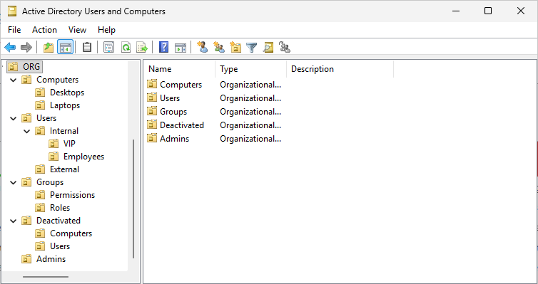
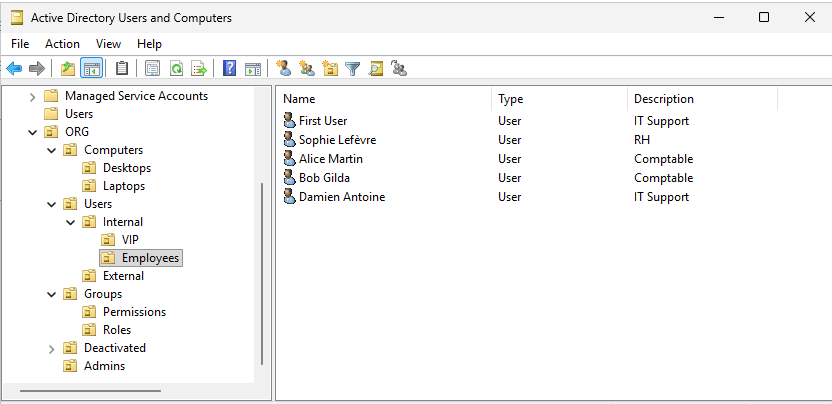
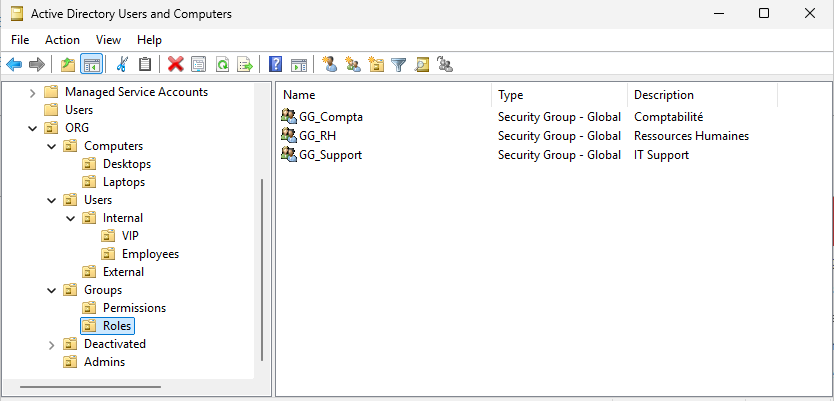
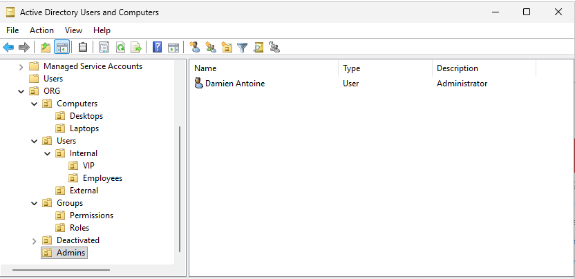
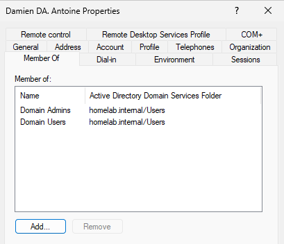
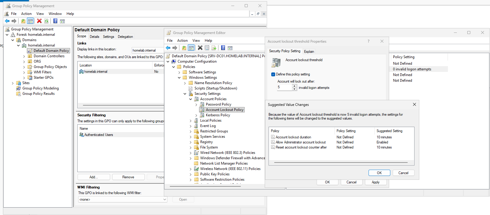

# Journal — 16 octobre 2026

## Objectif de la séance

Structurer l'annuaire Active Directory comme celui d'une petite entreprise (Homelab SARL, trois services), puis traiter les premières demandes des utilisateurs sous forme de tickets.

Séance menée en autonomie à partir d'une feuille de mission.

## Réalisé

- Création d'une arborescence d'unités d'organisation (UO)
- Définition des conventions de nommage
- Création des utilisateurs, des groupes de rôle et d'un compte d'administration nominatif
- Mise en place d'une stratégie de verrouillage des comptes
- Traitement de quatre tickets : mot de passe oublié, compte verrouillé, arrivée et départ d'un employé

## Arborescence de l'annuaire

```
homelab.internal
└── ORG
    ├── Computers
    │   ├── Desktops
    │   └── Laptops
    ├── Users
    │   ├── Internal
    │   │   ├── VIP
    │   │   └── Employees
    │   └── External
    ├── Groups
    │   ├── Permissions
    │   └── Roles
    ├── Deactivated
    └── Admins
```



### Choix d'organisation

| Choix | Justification |
| --- | --- |
| Classement par type d'objet | Les GPO s'appliquent aux UO : séparer postes fixes et portables permettra par exemple d'appliquer BitLocker aux seuls portables |
| Services portés par des groupes, pas par des UO | Arborescence stable même si l'organigramme change. Une GPO propre à un service se filtrera par groupe |
| `Internal` / `External` | Distinguer les employés des prestataires, dont les comptes ont souvent une date d'expiration |
| `VIP` | Utilisateurs aux accès sensibles (direction), traités en priorité par le support |
| `Admins` à la racine de `ORG` | Comptes d'administration séparés des comptes utilisateurs, pour leur appliquer des règles spécifiques |
| `Deactivated` à la racine de `ORG` | Les comptes désactivés ne reçoivent pas les GPO appliquées aux utilisateurs actifs |
| `Groups` séparé en `Roles` et `Permissions` | Méthode AGDLP : les utilisateurs vont dans des groupes de rôle, qui sont placés dans des groupes de permission, qui seuls reçoivent les droits |

Les UO créées sont protégées par défaut contre la suppression accidentelle.

## Conventions de nommage

| Élément | Convention | Exemples |
| --- | --- | --- |
| Utilisateurs | Initiale du prénom + nom, sans accents ni espaces. Homonyme : lettre suivante du prénom | `amartin`, `slefevre`, `tgirard` |
| Comptes d'administration | Identifiant + `.adm` | `dantoine.adm` |
| Groupes de rôle (globaux) | `GG_<Service>` | `GG_Compta`, `GG_RH`, `GG_Support` |
| Groupes de permission (domaine local) | `DL_<Ressource>_<Accès>` | À créer avec les partages de fichiers |

## Comptes et groupes

| Utilisateur | Service | Groupe de rôle | UO |
| --- | --- | --- | --- |
| First User (`fuser`) | Support informatique (compte de test) | `GG_Support` | `Employees` |
| Damien Antoine (`dantoine`) | Support informatique | `GG_Support` | `Employees` |
| Sophie Lefèvre (`slefevre`) | Ressources humaines | `GG_RH` | `Employees` |
| Alice Martin (`amartin`) | Comptabilité | `GG_Compta` | `Employees` |
| Bob Gilda (`bgilda`) | Comptabilité | `GG_Compta` | `Employees` |
| Thomas Girard (`tgirard`) | Comptabilité (arrivée le 19/10) | `GG_Compta` | `Employees` |

Bob Gilda remplace Karim Benali, prévu dans la feuille de mission.

Tous les utilisateurs restent membres de `Domain Users`, le groupe principal de tout compte du domaine. Il donne les droits de base, comme l'ouverture de session sur les postes.





### Compte d'administration nominatif

Le compte `dantoine.adm`, membre de `Domain Admins`, est utilisé à la place du compte `Administrator` intégré :
- **traçabilité** : chaque action d'administration est rattachée à une personne ;
- **moindre privilège** : le compte du quotidien (`dantoine`) n'a pas de droits d'administration ;
- **sécurité** : un nom générique comme « Admin » est le premier essayé par un attaquant.





## Changement : stratégie de verrouillage des comptes

Par défaut, aucun verrouillage n'était configuré : un compte pouvait subir un nombre illimité de tentatives de mot de passe.

| Paramètre (Default Domain Policy) | Valeur |
| --- | --- |
| Account lockout threshold | 5 tentatives |
| Account lockout duration | 10 minutes |
| Reset account lockout counter after | 10 minutes |
| Allow Administrator account lockout | Activé |

- Les règles de mot de passe et de verrouillage des comptes du domaine ne s'appliquent qu'au niveau du domaine, d'où leur place dans la **Default Domain Policy**. Liées à une UO, elles n'auraient aucun effet sur les comptes du domaine.
- Après `gpupdate /force`, `net accounts` affichait toujours « Lockout threshold: Never ». Le paramètre s'est appliqué au bout de quelques minutes : certains paramètres de sécurité sont appliqués en arrière-plan après la fin de `gpupdate`.



## Tickets traités

| Ticket | Type | Résumé |
| --- | --- | --- |
| [TKT-001](../tickets/tkt-001_mot-de-passe-oublie.md) | Demande de service | Mot de passe oublié (Bob Gilda) |
| [TKT-002](../tickets/tkt-002_compte-locked.md) | Incident | Compte verrouillé (Alice Martin) |
| [TKT-003](../tickets/tkt-003_nouvel-employe.md) | Demande de service | Arrivée d'un employé (Thomas Girard) |
| [TKT-004](../tickets/tkt-004_demission-bob.md) | Demande de service | Départ d'un employé (Bob Gilda) |

Les tickets sont rédigés en Markdown en attendant la mise en place de ServiceNow. Ils y seront ressaisis lors de sa prise en main.

## Notions clés

- **Unité d'organisation (UO) et conteneur** : les dossiers par défaut `Users` et `Computers` sont des conteneurs, auxquels on ne peut pas lier de GPO. Les UO le permettent.
- **Héritage des GPO** : une GPO liée à une UO s'applique à tout ce qu'elle contient, sous-UO comprises.
- **Étendue des groupes** : un groupe global regroupe des utilisateurs par rôle, un groupe domaine local reçoit les droits sur une ressource.
- **Incident ou demande de service** (ITIL) : un incident est un dysfonctionnement, une demande est un besoin standard et prévu.
- **Priorité** : elle se déduit de l'impact et de l'urgence, et non de l'importance perçue de la demande.
- **Verrouillage, expiration, désactivation** : trois états différents d'un compte. Le verrouillage suit des erreurs de mot de passe, l'expiration intervient à une date fixée, la désactivation est une action manuelle.
- **Désactiver plutôt que supprimer** : un compte supprimé puis recréé reçoit un nouvel identifiant (SID) et perd tous ses droits.
- **Ingénierie sociale** : toujours vérifier l'identité d'un demandeur avant de réinitialiser un mot de passe, et ne jamais transmettre un mot de passe par le même canal que le ticket.

## Points ouverts

- Rédiger une procédure d'arrivée et de départ d'un employé dans `procedures/`.

## Prochaine étape

Partages de fichiers et droits NTFS, avec la mise en œuvre de la méthode AGDLP.
