# Journal — 19 octobre 2026

## Objectif de la séance

Mettre en place les partages de fichiers des services de Homelab SARL, avec des droits d'accès construits selon la méthode AGDLP, puis traiter deux demandes d'utilisateurs liées aux accès.

Séance menée en autonomie à partir d'une feuille de mission.

## Réalisé

- Création du dossier racine `C:\Partages` et de trois sous-dossiers : `Compta`, `RH`, `Commun`
- Partage de la racine sur le réseau : `\\SRV-DC01\Partages`
- Création des groupes de permission (domaine local) et imbrication des groupes de rôle
- Configuration des droits NTFS : racine verrouillée, un groupe de permission par sous-dossier
- Connexion du lecteur réseau `Z:` sur PC-CLIENT01 et tests avec plusieurs utilisateurs
- Activation de la fonctionnalité *Privileged Access Management* de la forêt
- Traitement de deux tickets : TKT-005 et TKT-006

## Architecture retenue

Un seul partage racine contenant un dossier par service, plutôt qu'un partage par service :
- un seul partage à administrer et un seul lecteur réseau à connecter pour tous les utilisateurs ;
- l'ajout d'un service se limite à la création d'un sous-dossier et d'un groupe de permission.

Le partage s'appelait d'abord `Partagés`. Il a été renommé `Partages` : certains logiciels, scripts ou appareils gèrent mal les caractères accentués dans les chemins réseau, et la convention de nommage du lab exclut déjà les accents.

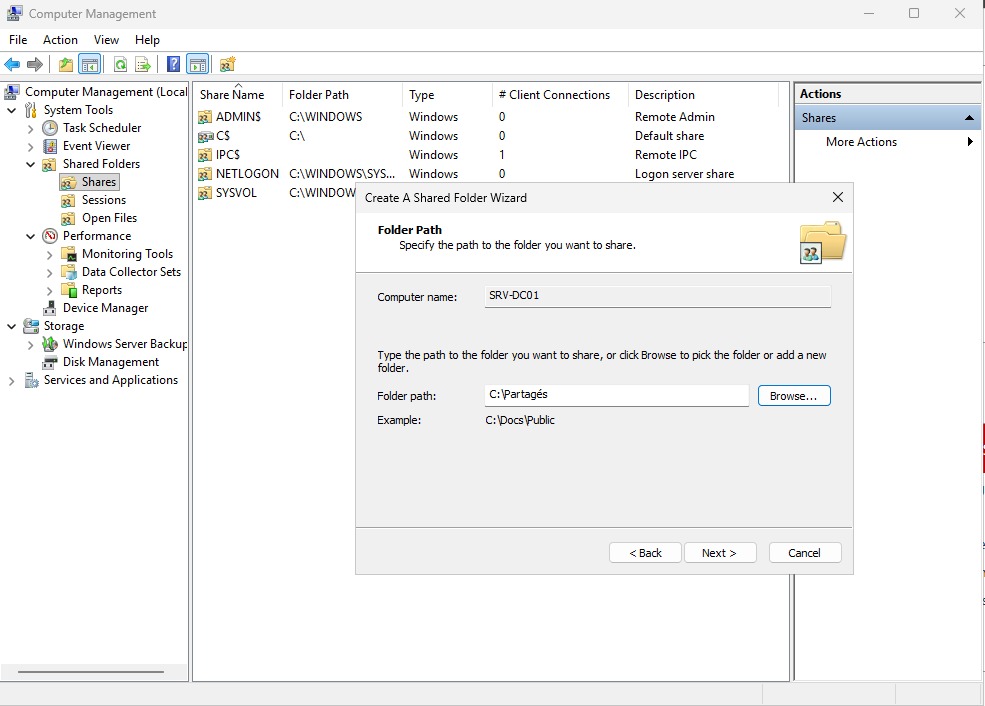

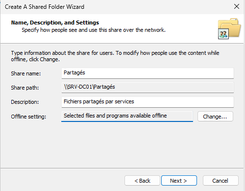

## Méthode AGDLP

```
Utilisateurs  →  Groupe global (rôle)  →  Groupe domaine local (permission)  →  Dossier
Alice, Thomas →  GG_Compta             →  DL_Partage-Compta_RW               →  Compta
```

| Groupe de permission (domaine local) | Membre(s) | Dossier |
| --- | --- | --- |
| `DL_Partage-Compta_RW` | `GG_Compta` | `Compta` |
| `DL_Partage-RH_RW` | `GG_RH` | `RH` |
| `DL_Partage-Commun_RW` | `Domain Users` | `Commun` |
| `DL_Partage-Compta_R` | `GG_Audit-Compta` | `Compta`, lecture seule (TKT-006) |

- Les droits NTFS sont attribués aux groupes de permission, jamais directement aux utilisateurs.
- Un mouvement de personnel ne modifie que les groupes de rôle. Un nouveau dossier ne demande qu'un nouveau groupe de permission.
- `Domain Users` est placé dans `DL_Partage-Commun_RW` : tout compte du domaine, y compris un nouvel arrivant sans groupe de service, accède automatiquement au dossier commun.
- Seuls les groupes réellement nécessaires sont créés : `_RW` pour chaque service, `_R` uniquement lorsqu'un besoin de lecture seule est apparu (TKT-006).

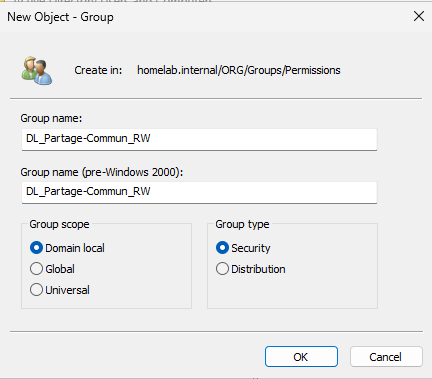

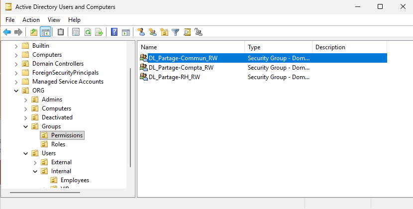

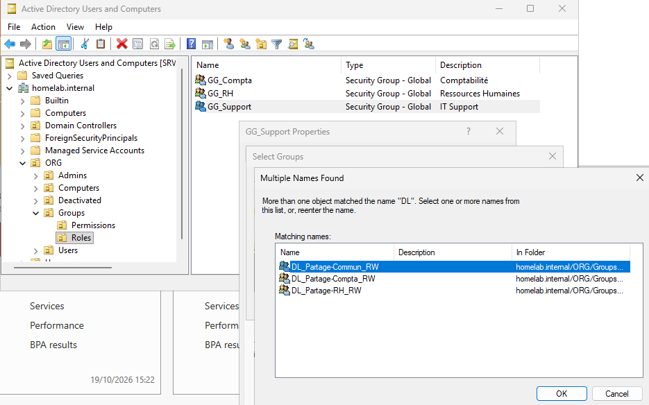

## Droits du partage et droits NTFS

Un dossier partagé a deux niveaux de droits, et l'accès réel par le réseau est le plus restrictif des deux :

| | Droits de partage | Droits NTFS |
| --- | --- | --- |
| S'appliquent | Uniquement par le réseau | Toujours, en local comme par le réseau |
| Portée | Le partage entier | Chaque dossier et fichier, avec héritage |
| Niveaux | Read, Change, Full Control | Une douzaine de droits, plus les droits avancés |

Principe retenu : des droits de partage larges pour les utilisateurs authentifiés, et toute la finesse gérée par NTFS.

Le groupe `Everyone`, présent par défaut sur le partage, a été remplacé par `Authenticated Users`, qui ne contient que des comptes authentifiés.

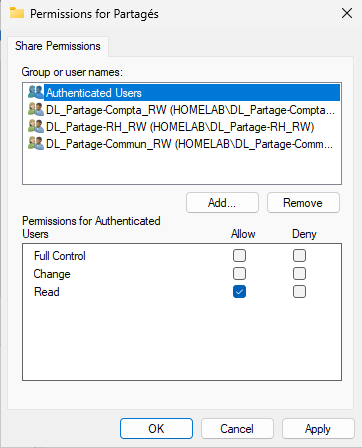

### Dossier racine

Le dossier racine héritait des droits de `C:\`, dont ceux du groupe intégré `Users`. Sur un contrôleur de domaine, ce groupe contient tous les utilisateurs du domaine : tout le monde pouvait lire la racine, et ces droits seraient descendus dans tous les sous-dossiers. En NTFS, les droits s'additionnent : ajouter un groupe sur un sous-dossier ne retire pas un accès hérité.

Correction :
1. Désactivation de l'héritage, avec conversion des droits hérités en droits explicites.
2. Suppression des entrées `Users`.
3. Conservation de `Administrators`, `SYSTEM` et `CREATOR OWNER`.
4. Ajout des trois groupes `DL_…_RW` en lecture, appliquée à **ce dossier seulement** (*This folder only*) : les utilisateurs peuvent ouvrir la racine pour atteindre leur dossier, sans que ce droit ne descende dans les sous-dossiers ni ne permette de créer des fichiers à la racine.

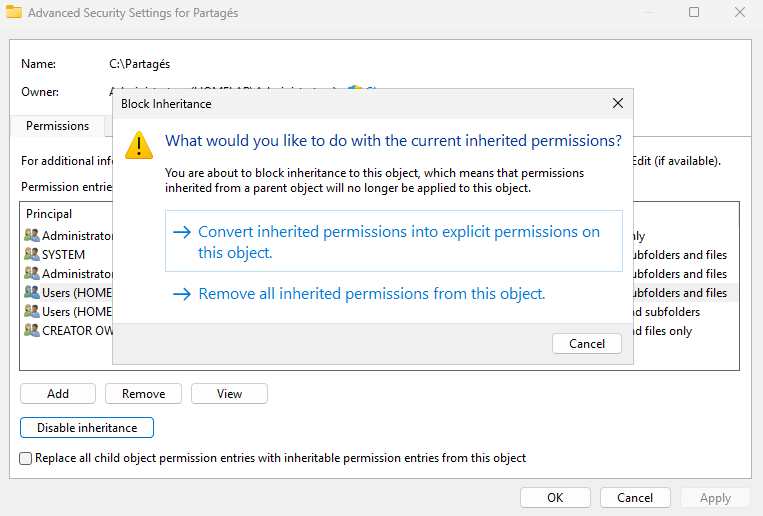

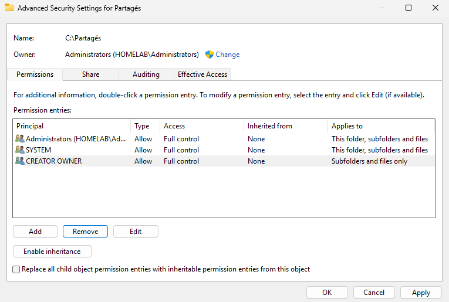

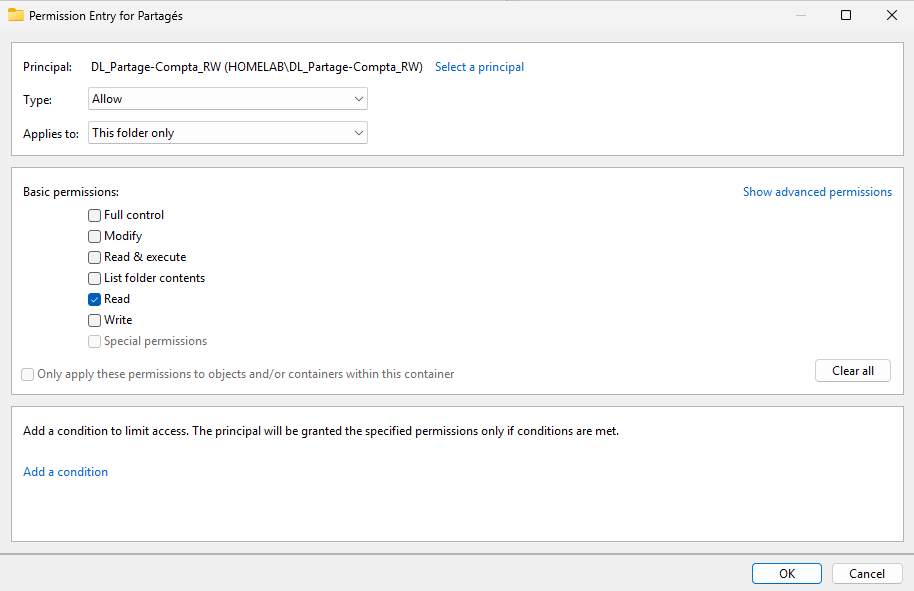

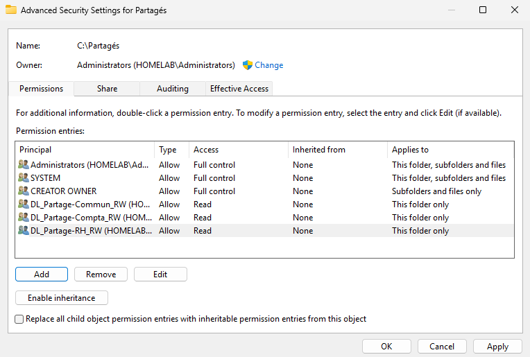

### Sous-dossiers

Les sous-dossiers conservent l'héritage de la racine (`Administrators`, `SYSTEM`, `CREATOR OWNER`) et reçoivent leur groupe de permission, appliqué au dossier, à ses sous-dossiers et à ses fichiers.

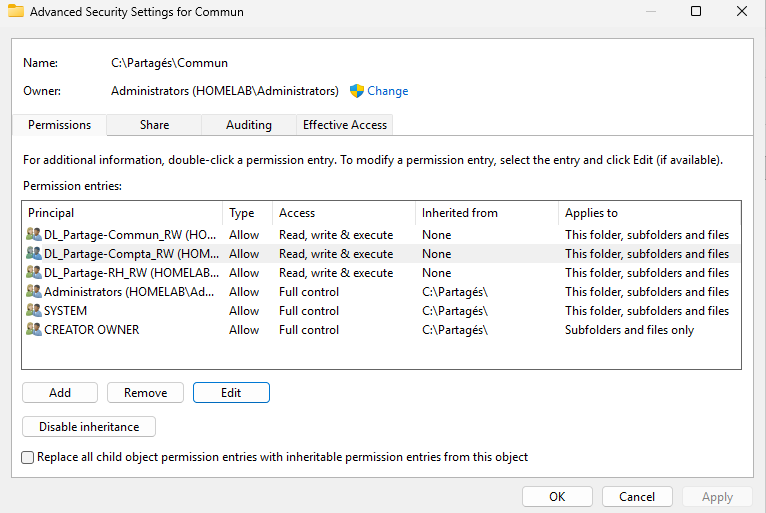

## Tests depuis PC-CLIENT01

Lecteur `Z:` connecté sur `\\SRV-DC01\Partages`. Tous les tests sont réalisés avec des comptes utilisateurs, jamais avec un compte administrateur.

| Utilisateur | Action | Résultat |
| --- | --- | --- |
| Alice Martin (Comptabilité) | Ouvrir `Compta` et y créer un dossier | Accès autorisé |
| Alice Martin | Ouvrir `RH` | Accès refusé |
| Utilisateur du domaine | Créer un fichier à la racine | Accès refusé |
| Thomas Girard, sans groupe de service | Ouvrir `Commun` | Accès autorisé, grâce à `Domain Users` |
| Thomas Girard, sans groupe de service | Ouvrir `Compta` | Accès refusé |
| Sophie Lefèvre (RH), après TKT-006 | Ouvrir `Compta` | Accès en lecture |

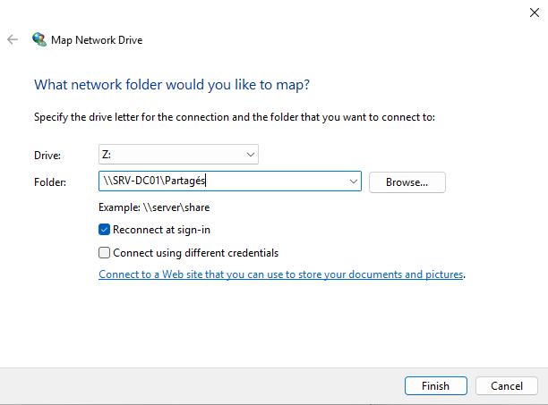

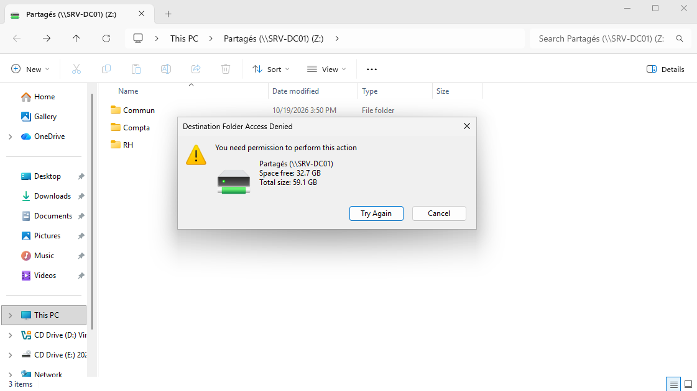

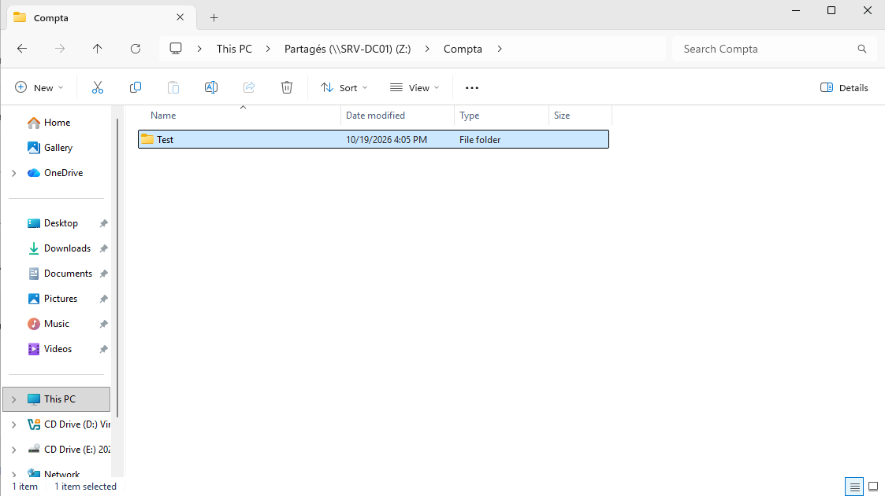

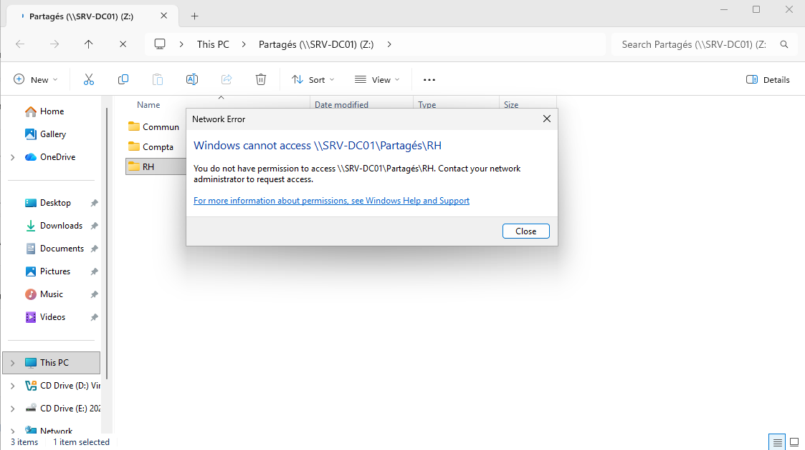

## Changement : activation de Privileged Access Management

La fonctionnalité *Privileged Access Management Feature* a été activée sur la forêt `homelab.internal` pour permettre des appartenances temporaires aux groupes (TKT-006).

- **Irréversible** : snapshot de SRV-DC01 pris avant l'activation.
- **Prérequis** : niveau fonctionnel de forêt Windows Server 2016 ou supérieur (ici 2025), et droits *Enterprise Admins*. L'opération a été réalisée avec le compte `Administrator`, `dantoine.adm` n'étant membre que de *Domain Admins*.
- En entreprise, cette activation relève d'une décision d'architecture, à valider avant toute mise en œuvre.

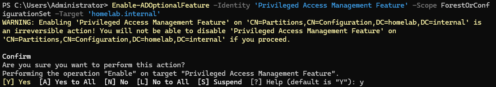

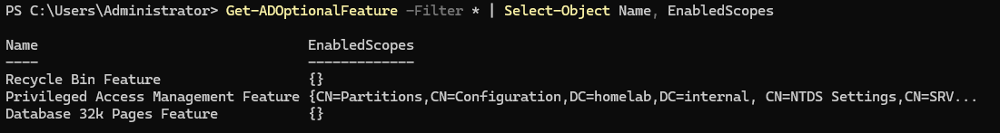

## Tickets traités

| Ticket | Type | Résumé |
| --- | --- | --- |
| [TKT-005](../tickets/tkt-005_acces-refuse-compta.md) | Incident | Accès refusé au dossier Compta après ajout au groupe |
| [TKT-006](../tickets/tkt-006_acces-temporaire-audit.md) | Demande de service | Accès temporaire en lecture au dossier Compta pour un audit |

## Corrections appliquées le 20/10/2026

Relecture des captures de la séance, puis correction des écarts constatés :

| Constat | Conséquence | Correction appliquée |
| --- | --- | --- |
| Droits du partage : `Authenticated Users` en *Read*. La capture *Effective Access* de Thomas sur `Compta` indiquait des écritures « limitées par le partage » | Aucune écriture possible par le réseau, quels que soient les droits NTFS | `Authenticated Users` passé en *Change*, groupes `DL_` retirés des droits du partage. La finesse reste gérée par NTFS : la racine n'accorde que la lecture, en *This folder only* |
| Droits NTFS des sous-dossiers : *Read, write & execute* | Les utilisateurs pouvaient créer et modifier, mais pas supprimer ni renommer | Deux entrées par groupe de permission : *Read & execute* sur **ce dossier seulement**, et *Modify* sur **les sous-dossiers et fichiers seulement** |
| `Commun` contenait `DL_Partage-Compta_RW` et `DL_Partage-RH_RW` en plus de `DL_Partage-Commun_RW` | Entrées redondantes depuis l'ajout de `Domain Users` | Seul `DL_Partage-Commun_RW` est conservé |

Pourquoi deux entrées plutôt qu'un simple *Modify* : *Modify* appliqué au dossier lui-même permettrait à un utilisateur de supprimer ou de renommer le dossier `Compta` entier. Avec la séparation, il gère librement le contenu, mais le dossier du service reste en place.

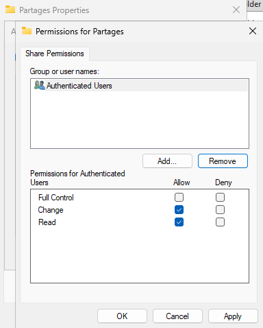

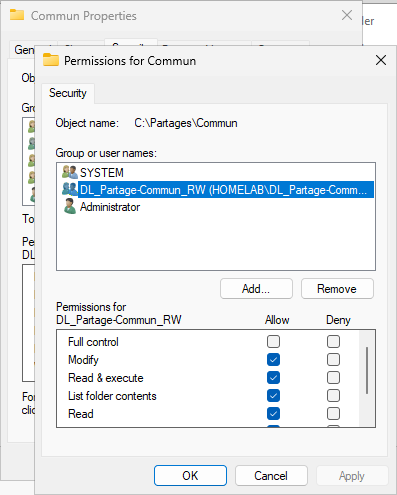

## Notions clés

- **AGDLP** : Accounts → Global → Domain Local → Permissions. Les utilisateurs vont dans des groupes globaux de rôle, imbriqués dans des groupes domaine local de permission, seuls à recevoir les droits.
- **Droits de partage et droits NTFS** : deux niveaux combinés, le plus restrictif l'emporte.
- **Héritage NTFS** : un dossier hérite des droits de son parent. Les droits s'additionnent : un accès hérité ne disparaît pas quand on ajoute un groupe.
- **This folder only** : un droit qui ne s'applique qu'au dossier lui-même, sans descendre vers son contenu.
- **Subfolders and files only** : l'inverse, un droit qui s'applique au contenu sans s'appliquer au dossier lui-même. Combinés, ils protègent un dossier de service contre la suppression tout en laissant ses utilisateurs gérer son contenu.
- **`Users` et `Domain Users`** : `Users` est un groupe local intégré, `Domain Users` est le groupe global de tous les comptes du domaine.
- **Effective Access** : simulateur des droits NTFS d'un utilisateur sur un dossier, qui indique aussi si le partage limite l'accès. Outil de diagnostic, il n'attribue aucun droit.
- **Jeton de session** : les groupes d'un utilisateur sont pris en compte à l'ouverture de session. Un groupe ajouté pendant la session n'est effectif qu'après reconnexion.
- **Appartenance temporaire (PAM)** : un membre peut être ajouté à un groupe pour une durée limitée, au terme de laquelle il en sort automatiquement.

## Prochaine étape

Stratégies de groupe (GPO) : connexion automatique du lecteur réseau, paramètres des postes.
