# Journal — 20 octobre 2026

## Objectif de la séance

Appliquer les corrections issues de la relecture du 19/10, masquer aux utilisateurs les dossiers auxquels ils n'ont pas accès, puis automatiser la connexion des lecteurs réseau par stratégie de groupe (GPO).

Séance menée en autonomie à partir d'une feuille de mission.

## Réalisé

- Corrections des droits du partage `Partages` et des sous-dossiers (détail dans le [journal du 19/10/2026](2026-10-19.md#corrections-appliquées-le-20102026))
- Activation de l'énumération basée sur l'accès (ABE) sur le partage `Partages`
- Création de la GPO `U_Lecteur-Partages` : connexion automatique de `Z:` pour tous les utilisateurs
- Création du partage `Archives-Compta` et connexion automatique de `Y:` pour la comptabilité uniquement, par ciblage au niveau de l'élément
- Définition d'une convention de nommage des GPO

## Énumération basée sur l'accès (ABE)

Avant activation, tous les utilisateurs voyaient les trois dossiers de `Z:`, y compris ceux qu'ils ne pouvaient pas ouvrir.

Activation : *Server Manager* → *File and Storage Services* → *Shares* → propriétés de `Partages` → *Settings* → *Enable access-based enumeration*.

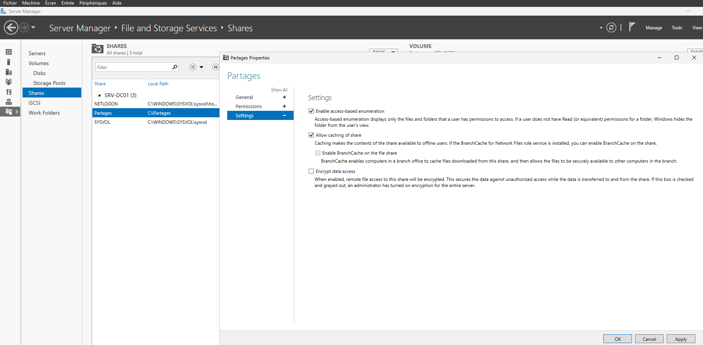

| Utilisateur | Action | Résultat |
| --- | --- | --- |
| Thomas Girard (Comptabilité) | Ouvrir `Z:` | Seuls `Commun` et `Compta` sont visibles |
| Thomas Girard | Saisir `\\SRV-DC01\Partages\RH` dans la barre d'adresse | Accès refusé |

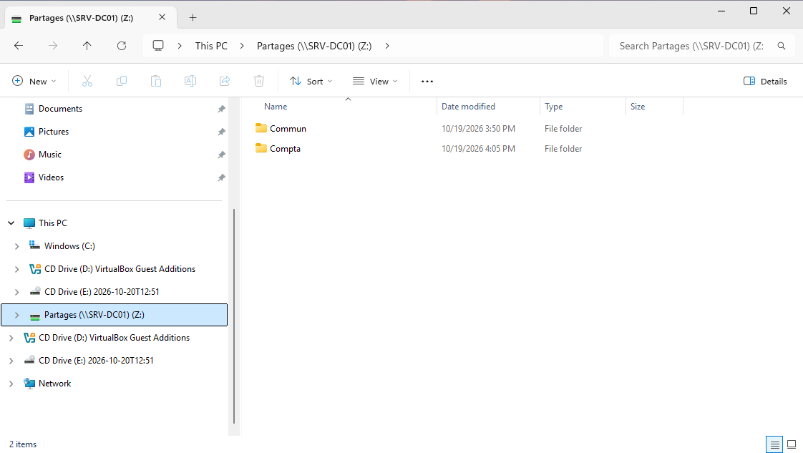

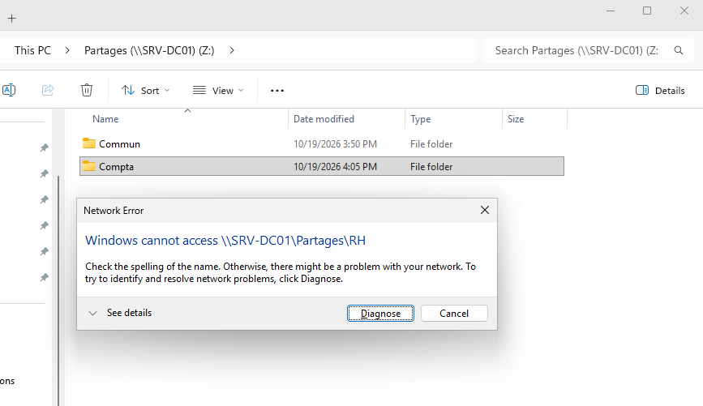

Constats :
- L'ABE **masque** les dossiers, il ne protège rien. Quand Thomas saisit le chemin de `RH`, ce sont les droits NTFS qui refusent l'accès, comme avant l'activation.
- Le message affiché n'est pas « Accès refusé », mais une erreur réseau : « Windows cannot access \\SRV-DC01\Partages\RH », avec un bouton *Diagnose*, et « Unspecified error » dans le détail. Un utilisateur qui voit ce message signalera un problème réseau alors qu'il s'agit d'un refus de droits : à garder en tête lors du diagnostic.

## GPO : connexion automatique des lecteurs réseau

### Convention de nommage des GPO

`<Portée>_<Objet>` :
- `U_` pour une GPO de configuration utilisateur, `C_` pour une GPO de configuration ordinateur ;
- l'objet décrit ce que fait la GPO, sans accents.

La GPO, créée sous le nom `User_Mapper_Lecteur`, a été renommée `U_Lecteur-Partages`. Une GPO est identifiée par son GUID : le renommage ne modifie ni son lien ni son application.

### Lecteur `Z:` pour tous les utilisateurs

| Choix | Valeur | Raison |
| --- | --- | --- |
| GPO | Nouvelle GPO dédiée | La *Default Domain Policy* reste réservée aux paramètres de domaine (mots de passe, verrouillage) |
| Partie | *User Configuration* → *Preferences* → *Windows Settings* → *Drive Maps* | Le lecteur suit l'utilisateur, quel que soit le poste |
| Lien | OU `ORG > Users` | Tous les utilisateurs, internes et externes. Les comptes d'administration, dans `ORG > Admins`, ne sont pas concernés |
| Action | *Update* | Complète un lecteur `Z:` existant sans le déconnecter, contrairement à *Replace* qui le supprime et le recrée à chaque application |
| Contexte | *Run in logged-on user's security context* | La connexion se fait avec les droits de l'utilisateur : NTFS et l'ABE s'appliquent normalement |

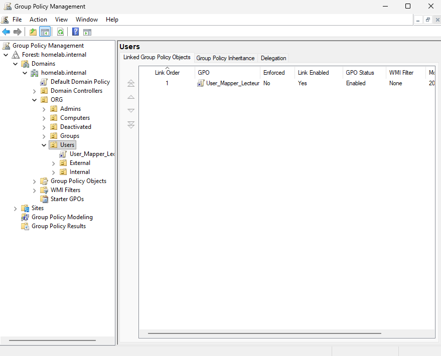

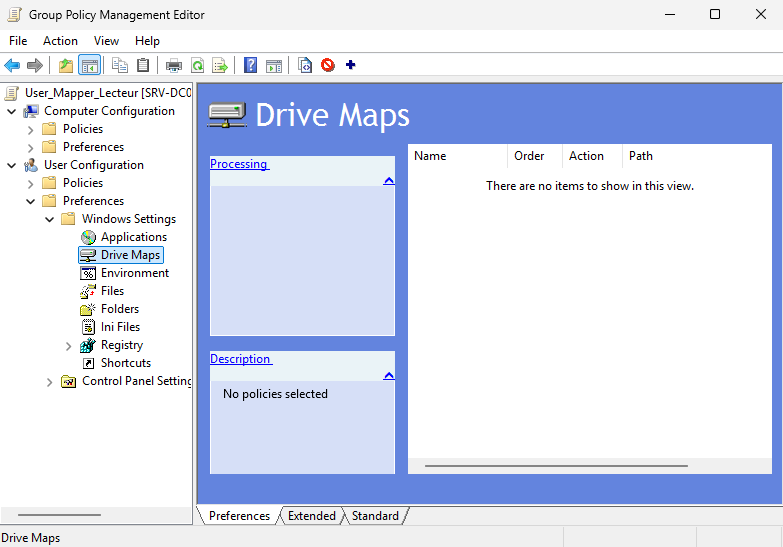

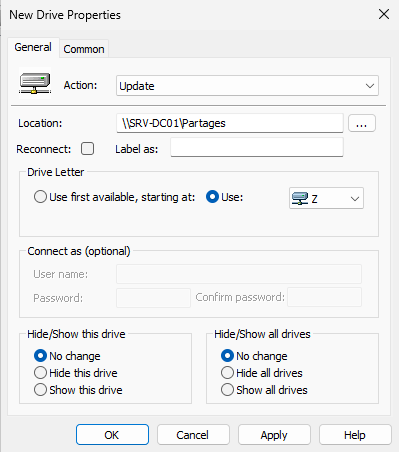

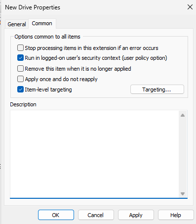

### Vérification depuis PC-CLIENT01

Session de Thomas Girard, sans lecteur connecté, puis `gpupdate /force` :

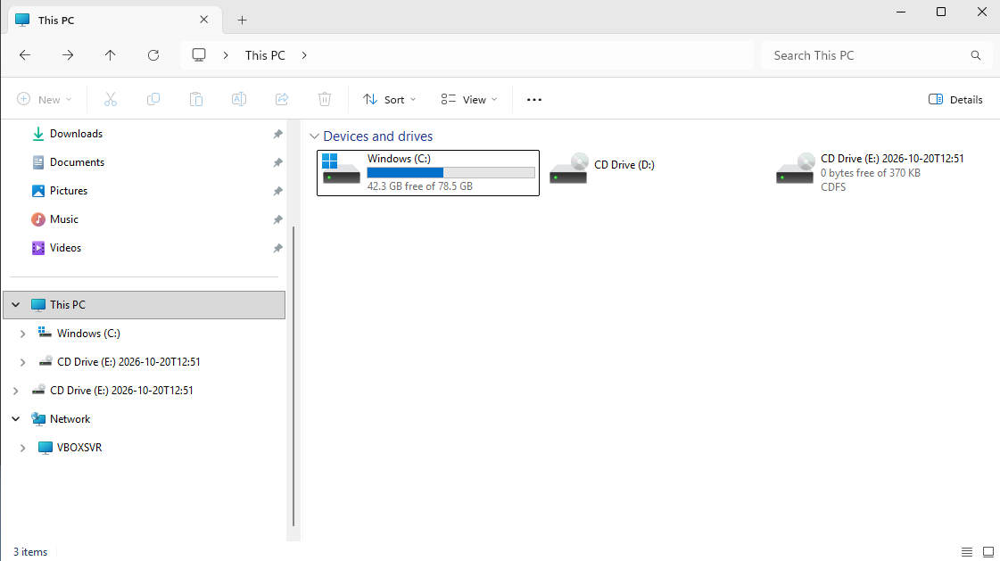

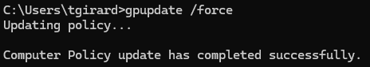

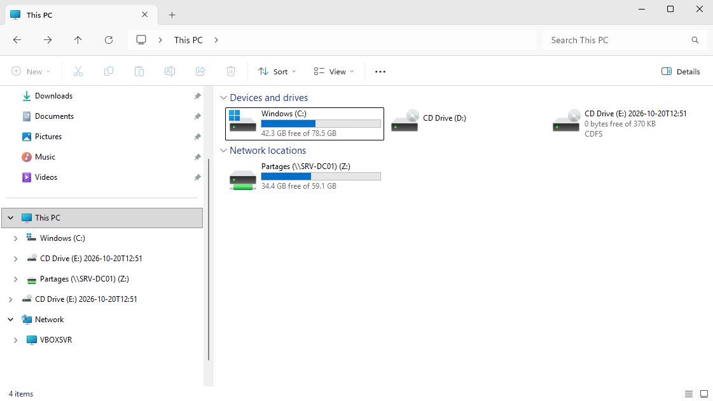

Preuve de l'application, partie utilisateur :

```
gpresult /r /scope user
```

```
USER SETTINGS
    CN=Thomas Girard,OU=Employees,OU=Internal,OU=Users,OU=ORG,DC=homelab,DC=internal
    Last time Group Policy was applied: 10/20/2026 at 3:33:49 PM
    Group Policy was applied from:      SRV-DC01.homelab.internal

    Applied Group Policy Objects
    -----------------------------
        User_Mapper_Lecteur
```

La sortie affiche l'ancien nom : la dernière application (15:33) précède le renommage.

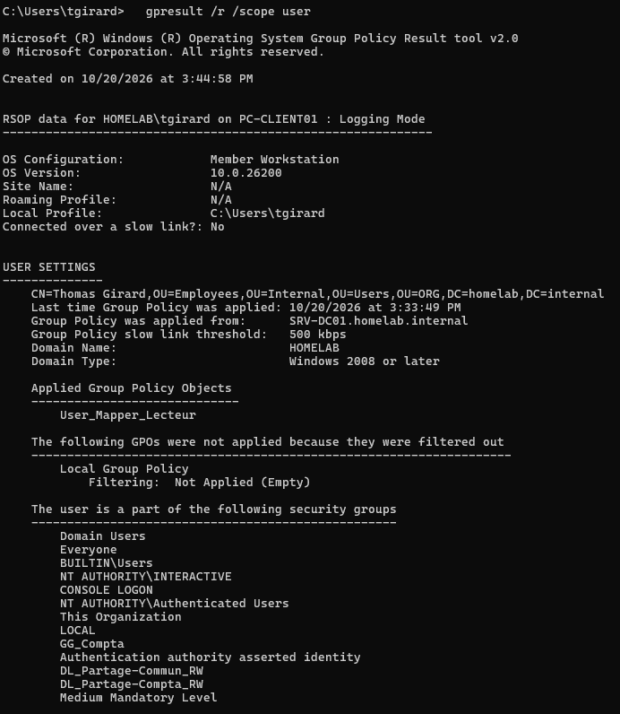

### Lecteur `Y:` réservé à la comptabilité

Objectif : distribuer, dans la même GPO, un lecteur à une partie seulement des utilisateurs qui la reçoivent.

**Partage `Archives-Compta`**, créé en dehors de `Partages` :
- `C:\Archives-Compta`, partagé en `\\SRV-DC01\Archives-Compta`
- Droits du partage : `Everyone` retiré, `Authenticated Users` en *Change*
- NTFS : héritage désactivé, `BUILTIN\Users` retiré, `DL_Archives-Compta_RW` (membre : `GG_Compta`) en *Modify*
- Une seule entrée *Modify* suffit : le dossier est la racine du partage, qui ne peut pas être supprimée depuis le réseau. Pour `Compta`, sous-dossier de `Partages`, la séparation en deux entrées reste nécessaire.

Convention : la partie ressource du nom d'un groupe de permission reprend le nom du partage, suivi du dossier si besoin (`DL_Partage-Compta_RW` pour le dossier `Compta` du partage `Partages`, `DL_Archives-Compta_RW` pour le partage `Archives-Compta`).

**Lecteur `Y:`**, ajouté à `U_Lecteur-Partages` :
- Action *Update*, chemin `\\SRV-DC01\Archives-Compta`
- Ciblage au niveau de l'élément : *Security Group* → `GG_Compta`, *User in group*

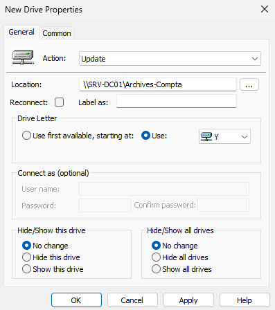

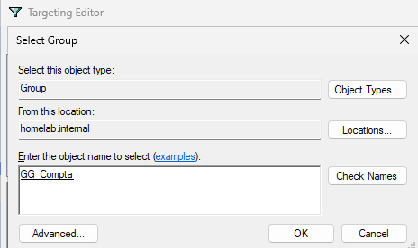

**Tests :**

| Utilisateur | Vérification | Résultat |
| --- | --- | --- |
| Sophie Lefèvre (RH) | *Effective Access* sur `Archives-Compta` | Aucun droit, limité par les droits NTFS |
| Thomas Girard (Comptabilité) | Ouverture de session | `Y:` et `Z:` connectés |
| Thomas Girard | Création d'un dossier dans `Y:` | Autorisée |
| Sophie Lefèvre | Ouverture de session | Seul `Z:` est connecté |

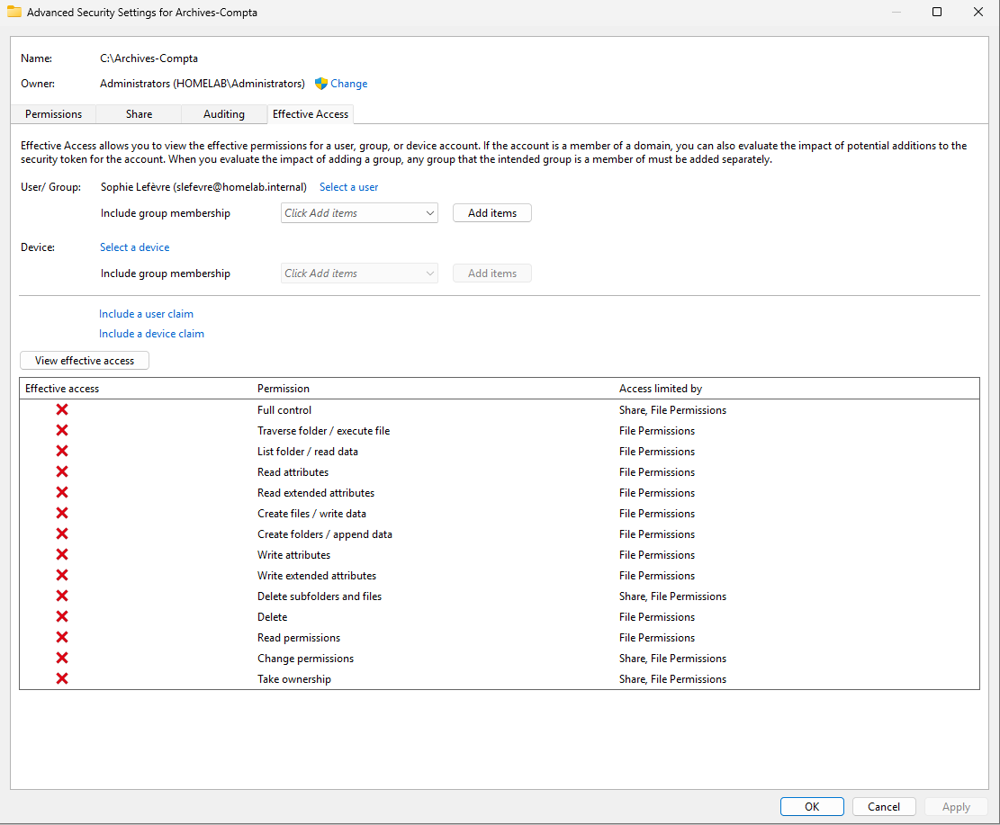

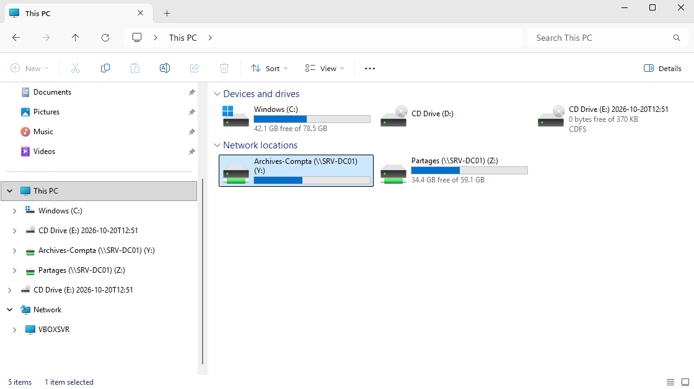

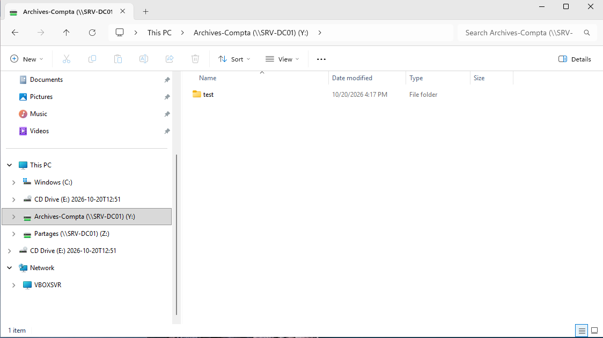

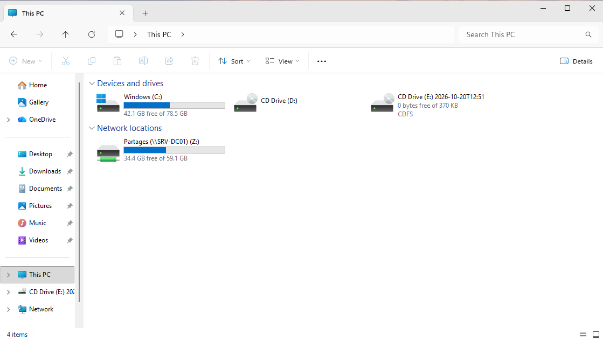

*Effective Access* indique aussi que *Full control*, *Change permissions*, *Take ownership* et *Delete subfolders and files* sont limités par le partage : en *Change*, le partage n'autorise jamais la modification des droits ni la prise de possession depuis le réseau, quels que soient les droits NTFS.

Le ciblage donne le lecteur, pas l'accès : un utilisateur hors de `GG_Compta` qui saisirait le chemin à la main serait bloqué par NTFS.

## Notions clés

- **Access-Based Enumeration** : réglage du partage qui masque les dossiers sur lesquels l'utilisateur n'a pas au moins la lecture. Confort et discrétion, pas sécurité : seuls les droits NTFS bloquent l'accès.
- **GPO** : ensemble de paramètres appliqué aux utilisateurs ou ordinateurs des OU auxquelles elle est liée. Deux parties : *Computer Configuration*, appliquée au démarrage du poste, et *User Configuration*, appliquée à l'ouverture de session.
- **Policies et Preferences** : les *Policies* imposent un paramètre que l'utilisateur ne peut pas modifier, les *Preferences* configurent un élément (lecteur, raccourci, imprimante) qu'il peut ensuite changer.
- **Filtres d'une GPO**, du plus large au plus fin : lien (OU), filtrage de sécurité (droit *Apply*), filtre WMI (condition sur le poste), ciblage au niveau de l'élément (un seul élément des *Preferences*).
- **Ciblage au niveau de l'élément** : utile quand il écarte une partie de ceux que le lien inclut. Un ciblage qui reprend le lien n'apporte rien et complique le diagnostic : `gpresult` affiche la GPO comme appliquée même quand un élément a été écarté.
- **`gpupdate /force` et `gpresult /r`** : le premier force l'application des GPO, le second affiche celles qui s'appliquent réellement, avec `/scope user` ou `/scope computer`.

## Prochaine étape

GPO de configuration ordinateur : paramètres et restrictions des postes de travail.
