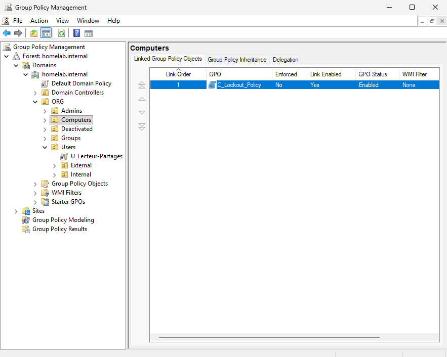
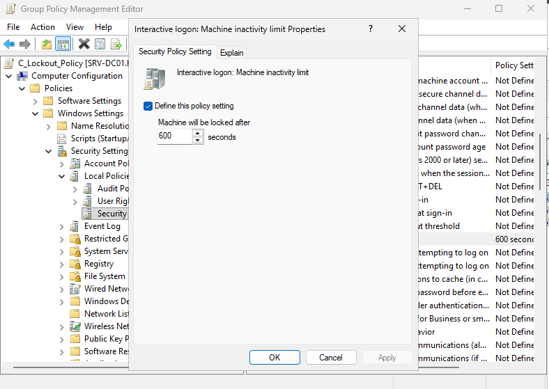
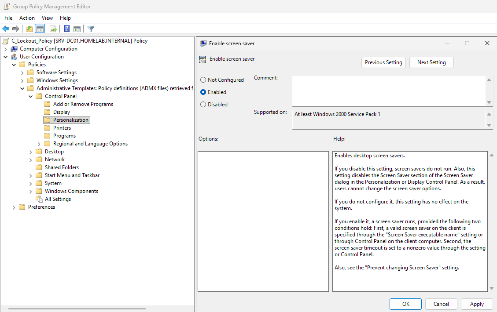
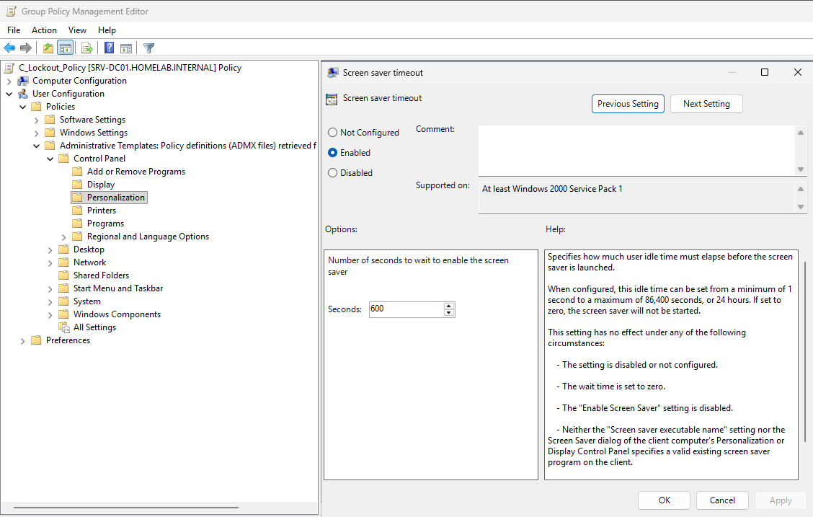
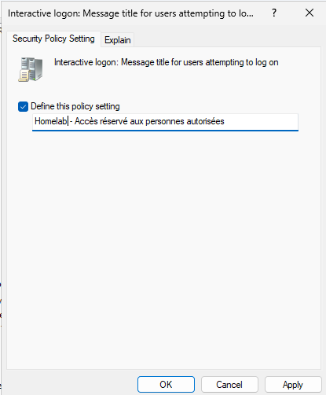
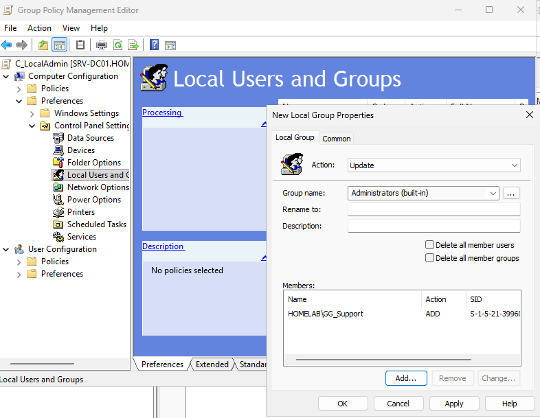
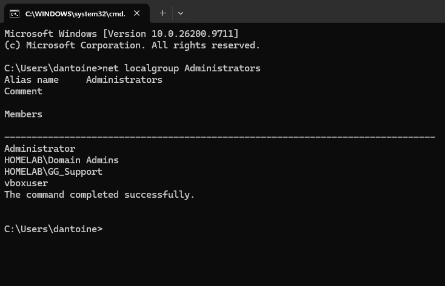
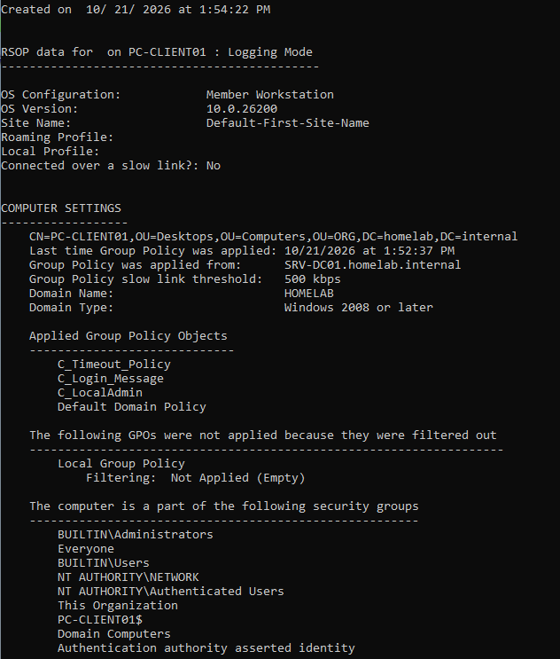

# Journal — 21 octobre 2026

## Objectif de la séance

Configurer les postes de travail par des GPO de configuration ordinateur : verrouillage de session après inactivité, message de charte informatique avant la connexion, droits d'administration locale pour le support. Puis traiter un incident lié à l'application des GPO.

Séance menée en autonomie à partir d'une feuille de mission.

## Réalisé

- Création et lien de trois GPO de configuration ordinateur sur `ORG > Computers` : `C_Timeout_Policy`, `C_Login_Message`, `C_LocalAdmin`
- Correction d'une erreur de conception sur la GPO de verrouillage
- Mise en évidence du fonctionnement de l'UAC sur un compte administrateur local
- Traitement du ticket TKT-007

## GPO des postes de travail

Toutes les GPO sont liées à `ORG > Computers`, dont PC-CLIENT01 occupe la sous-OU `Desktops`. Les contrôleurs de domaine, dans l'OU `Domain Controllers`, ne sont pas concernés. La *Default Domain Policy* et la *Default Domain Controllers Policy* n'ont pas été modifiées.

| GPO | Réglage | Emplacement |
| --- | --- | --- |
| `C_Timeout_Policy` | *Interactive logon: Machine inactivity limit* = 600 secondes | *Computer Configuration* → *Policies* → *Windows Settings* → *Security Settings* → *Local Policies* → *Security Options* |
| `C_Login_Message` | *Interactive logon: Message title* et *Message text for users attempting to log on* | Même emplacement |
| `C_LocalAdmin` | `HOMELAB\GG_Support` ajouté au groupe local `Administrators (built-in)`, action *Update* | *Computer Configuration* → *Preferences* → *Control Panel Settings* → *Local Users and Groups* |



### Verrouillage après inactivité



Le réglage verrouille la session après 10 minutes sans activité, indépendamment de l'économiseur d'écran et des options d'alimentation. Il n'est pris en compte qu'après un redémarrage du poste.

À distinguer de la mise en veille de l'écran, réglée par les options d'alimentation : un écran éteint se rallume au moindre mouvement, une session verrouillée exige le mot de passe. Un utilisateur décrira souvent les deux situations de la même façon (« mon écran s'éteint »).

#### Première tentative : une GPO qui ne s'appliquait pas

La GPO, d'abord nommée `C_Lockout_Policy`, utilisait les réglages d'économiseur d'écran : *User Configuration* → *Administrative Templates* → *Control Panel* → *Personalization* → *Enable screen saver* et *Screen saver timeout* = 600.





`gpresult /r /scope computer` ne la listait pas parmi les GPO appliquées. Causes :
- La partie utilisateur d'une GPO ne s'applique qu'aux comptes utilisateurs présents dans l'OU liée. La GPO était liée à `ORG > Computers`, alors que les utilisateurs sont dans `ORG > Users` : ses réglages ne s'appliquaient à personne.
- Même appliquée, elle n'aurait pas verrouillé la session : il manquait *Password protect the screen saver*, sans lequel l'économiseur disparaît sans demander de mot de passe, et un économiseur défini (*Screen saver executable name*).

Correction : réglages utilisateur remis à *Not Configured*, remplacés par *Machine inactivity limit* dans la partie ordinateur. GPO renommée `C_Timeout_Policy`, pour éviter la confusion avec le verrouillage des **comptes** (*account lockout*) après des échecs de mot de passe.

### Message de charte informatique



- **Titre** : `Homelab - Accès réservé aux personnes autorisées`
- **Texte** : `Ce poste est la propriété de Homelab SARL. Son utilisation est soumise à la charte informatique de l'entreprise. Les connexions et les accès aux ressources peuvent être journalisés. En poursuivant vous reconnaissez avoir pris connaissance de la charte et vous engagez à la respecter.`

Le texte est rédigé sans virgule : dans ce réglage, une virgule peut être interprétée comme un séparateur de lignes et produire un retour à la ligne ou des guillemets dans le message affiché.

Le message s'affiche après `Ctrl+Alt+Suppr`, avant l'écran de connexion. L'utilisateur doit cliquer sur **OK** pour continuer.


Rôle : informer les utilisateurs des règles d'usage et de la journalisation possible des connexions, obligation de l'employeur en France. Le message rappelle la charte informatique complète à chaque ouverture de session, y compris à distance.

### Administrateurs locaux pour le support



- Action *Update* : ajoute `GG_Support` au groupe sans toucher aux membres existants. *Delete all member users* et *Delete all member groups* restent décochés : cochés, ils videraient le groupe à chaque application.
- Les *Restricted Groups* ont été écartés : ils **remplacent** tout le contenu du groupe, avec le risque de retirer des administrateurs existants.
- Aucun nouveau groupe n'est créé. Le groupe local `Administrators` de chaque poste joue le rôle du groupe de permission d'AGDLP :

```
dantoine, fuser  →  GG_Support  →  Administrators (local, sur chaque poste)  →  administration du poste
```

Séparation des comptes, principe du moindre privilège :

| Compte | Usage | Droits |
| --- | --- | --- |
| `dantoine` | Travail quotidien du technicien | Administrateur local des postes, par `GG_Support` |
| `dantoine.adm` | Administration du domaine, ponctuelle | *Domain Admins* |

Vérification sur PC-CLIENT01 :

```
C:\Users\dantoine>net localgroup Administrators
Members
-------------------------------------------------------------------------------
Administrator
HOMELAB\Domain Admins
HOMELAB\GG_Support
vboxuser
```



#### UAC : administrateur, mais pas dans toutes les invites

Dans une invite de commandes ouverte normalement par `dantoine`, `gpresult /r /scope computer` renvoyait « Access denied ». `whoami /groups` dans cette même invite :

```
BUILTIN\Administrators                     Alias            S-1-5-32-544     Group used for deny only
HOMELAB\GG_Support                         Group            S-1-5-21-...-1120  Mandatory group, Enabled by default, Enabled group
Mandatory Label\Medium Mandatory Level     Label            S-1-16-8192
```

- `BUILTIN\Administrators` est présent dans le jeton : `dantoine` est bien administrateur local.
- *Group used for deny only* et *Medium Mandatory Level* : l'invite n'est pas élevée. Le groupe ne sert qu'à refuser des accès, jamais à en accorder.
- Depuis Windows Vista, l'UAC donne deux jetons à un administrateur : un jeton filtré pour le travail courant, un jeton complet utilisé sur demande (*Exécuter en tant qu'administrateur*). Seul le compte `Administrator` intégré est exempté par défaut.

Solution : lancer l'invite avec *Exécuter en tant qu'administrateur*. Au support, c'est le premier réflexe face à « Je suis administrateur mais l'installation échoue » ou « Accès refusé » sur un outil système.

## Tests depuis PC-CLIENT01

| Vérification | Résultat |
| --- | --- |
| `gpresult /r /scope computer`, invite élevée | `C_Timeout_Policy`, `C_Login_Message`, `C_LocalAdmin` et *Default Domain Policy* appliquées |
| Démarrage du poste | Message de charte affiché avant l'écran de connexion |
| Session inactive 10 minutes | Session verrouillée |
| `net localgroup Administrators` | `HOMELAB\GG_Support` membre |
| `whoami /groups` de `dantoine` | `BUILTIN\Administrators` présent dans le jeton |



## Ticket traité

| Ticket | Type | Résumé |
| --- | --- | --- |
| [TKT-007](../tickets/tkt-007_poste-sans-verrouillage.md) | Incident | Poste sans verrouillage automatique, placé dans le conteneur `Computers` par défaut |

## Constat : compte `vboxuser`

`vboxuser`, compte créé par l'installation automatique de VirtualBox, est administrateur local de PC-CLIENT01. En entreprise, un compte administrateur local au mot de passe connu, souvent identique sur tous les postes, est un risque : il permet de passer d'un poste à l'autre. La pratique courante est de le désactiver et de gérer le compte administrateur local intégré avec **LAPS** (*Local Administrator Password Solution*) : un mot de passe unique par poste, stocké dans Active Directory et renouvelé automatiquement.

## Notions clés

- **Lien de GPO** : une GPO est stockée dans le dossier *Group Policy Objects* et liée à une ou plusieurs OU. Supprimer un lien ne supprime pas la GPO ; supprimer la GPO supprime tous ses liens.
- **Partie ordinateur et partie utilisateur** : une GPO liée à une OU d'ordinateurs n'applique que sa partie ordinateur, une GPO liée à une OU d'utilisateurs que sa partie utilisateur. Pour appliquer des réglages utilisateur selon le poste utilisé (salle de réunion, kiosque), il existe le **mode de bouclage** (*loopback processing*).
- **Ordre LSDOU** : Local → Site → Domaine → OU parente → OU enfant. En cas de conflit, la dernière GPO appliquée gagne ; les réglages sans conflit s'additionnent. Dans une même OU, le lien n° 1 gagne. Une GPO *Enforced* l'emporte sur les GPO des niveaux inférieurs et ignore le *Block Inheritance*.
- **Exception** : les stratégies de mot de passe et de verrouillage des comptes du domaine ne sont lues que depuis une GPO liée au domaine.
- **Conteneur `Computers`** : emplacement par défaut des ordinateurs joints au domaine. Ce n'est pas une OU : aucune GPO ne peut y être liée. `redircmp` change cet emplacement par défaut.
- **UAC** : un administrateur travaille avec un jeton filtré et doit demander l'élévation pour les actions sensibles. `whoami /groups` le montre : *Group used for deny only* et *Medium Mandatory Level* dans une invite non élevée.
- **Restricted Groups et Preferences** : les premiers remplacent le contenu d'un groupe local, les secondes peuvent y ajouter des membres sans toucher aux autres.
- **`gpresult /h rapport.html`** : rapport détaillé qui indique, pour chaque réglage, la GPO qui l'a emporté (*Winning GPO*).

## Prochaine étape

Prise en main à distance des postes et administration du domaine depuis PC-CLIENT01 avec les outils RSAT.
