# Journal — 22 octobre 2026

## Objectif de la séance

Faire travailler le support comme en entreprise : depuis son poste, avec son compte du quotidien (`dantoine`), sans ouvrir de session sur le contrôleur de domaine. Installer les outils d'administration sur PC-CLIENT01, déléguer au support uniquement les droits dont il a besoin, puis mettre en place la prise en main à distance des postes.

Séance menée en autonomie à partir d'une feuille de mission.

## Réalisé

- Installation de RSAT sur PC-CLIENT01 : outils Active Directory et gestion des stratégies de groupe
- Délégation à `GG_Support` de la réinitialisation des mots de passe et du déverrouillage des comptes sur `ORG > Users`
- Tests de la délégation depuis PC-CLIENT01 avec `dantoine`, y compris les actions qui doivent être refusées
- Activation du Bureau à distance sur les postes de travail par GPO, avec ouverture du pare-feu limitée à une adresse
- Connexion en Bureau à distance à PC-CLIENT01 depuis SRV-DC01 avec le compte `dantoine`

## RSAT sur PC-CLIENT01

**RSAT** (*Remote Server Administration Tools*) : les consoles d'administration du serveur (ADUC, GPMC, DNS, DHCP…), installées sur un poste client et connectées à distance au contrôleur de domaine.

Sur Windows 11, RSAT est une fonctionnalité à la demande, téléchargée depuis Windows Update : *Paramètres* → *Système* → *Fonctionnalités facultatives* → *Afficher les fonctionnalités*. Seuls les outils utiles au support ont été installés :

| Fonctionnalité | Outils |
| --- | --- |
| *RSAT: Active Directory Domain Services and Lightweight Directory Services Tools* | *Active Directory Users and Computers*, *Active Directory Administrative Center*, module PowerShell `ActiveDirectory` |
| *RSAT: Group Policy Management Tools* | *Group Policy Management* |

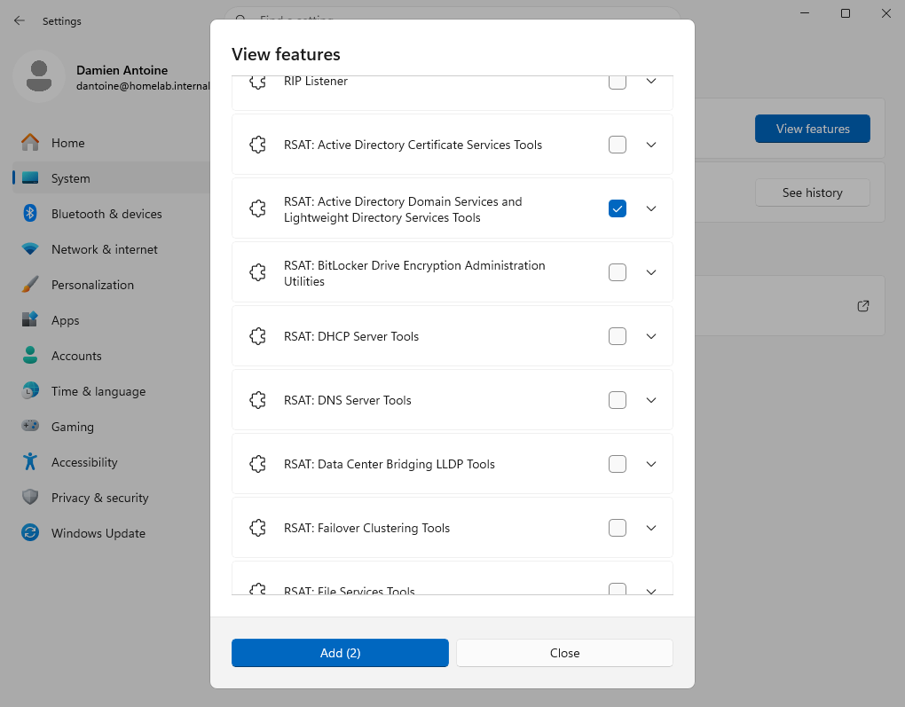

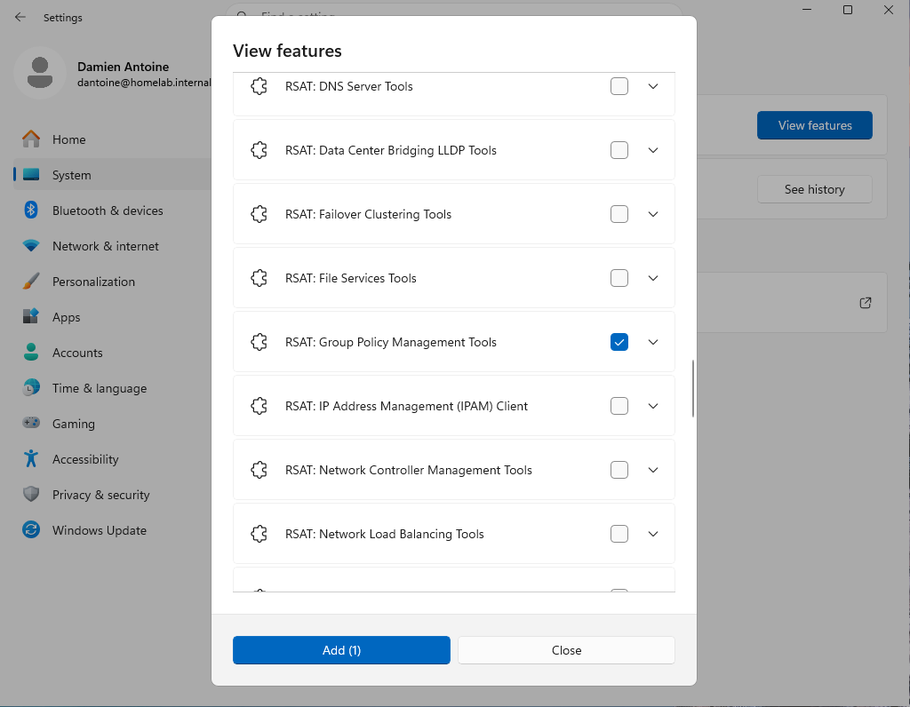

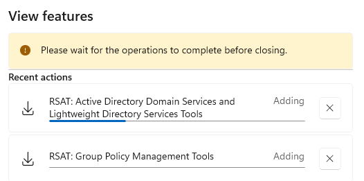

L'installation demande d'être administrateur local, ce que `dantoine` est depuis la GPO `C_LocalAdmin` du 21/10. L'**utilisation** des consoles, elle, n'en demande pas : ce que la console permet de modifier dépend uniquement des droits du compte dans l'annuaire.

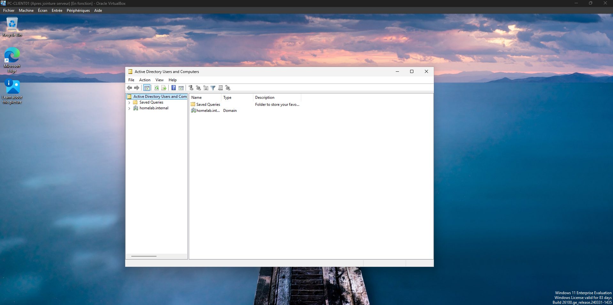

## Délégation au support

Chaque objet Active Directory a sa propre liste de contrôle d'accès, comme un dossier NTFS, avec héritage. **Déléguer**, c'est ajouter à une OU des entrées précises pour un groupe. L'assistant *Delegate Control* ne fait qu'écrire ces entrées.

### Périmètre

Délégation sur `ORG > Users` : les droits descendent vers `Internal` (`Employees`, `VIP`) et `External`. `Admins`, `Groups` et `Computers` restent hors de portée du support.

Choix à réévaluer en entreprise : les comptes de la direction (`VIP`) sont souvent réservés au niveau 2, pour limiter le risque d'ingénierie sociale (« c'est le directeur, réinitialisez mon mot de passe »). L'arborescence permettrait de déléguer seulement sur `Employees` et `External`.

### Droits délégués à `GG_Support`

L'assistant ne traite qu'un choix par passage : il a été lancé deux fois.

| Passage | Type de tâche | Contenu |
| --- | --- | --- |
| 1 | Tâche courante | *Reset user passwords and force password change at next logon* |
| 2 | Tâche personnalisée | Objets *User* uniquement, sans création ni suppression ; droits par propriété *Read lockoutTime* et *Write lockoutTime* |

Le déverrouillage n'existe pas en tâche courante. Un compte est verrouillé quand l'attribut `lockoutTime` contient une date ; le débloquer revient à le remettre à zéro, ce que fait la case *Unlock the user's account* d'ADUC.

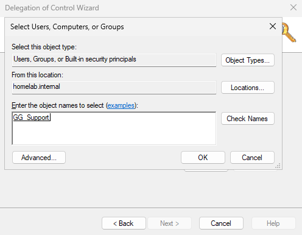

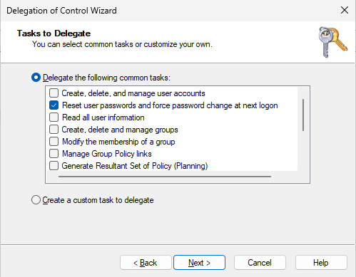

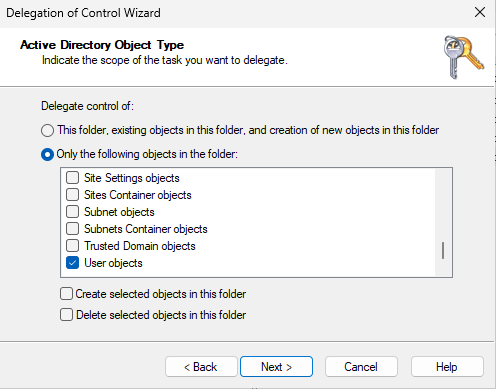

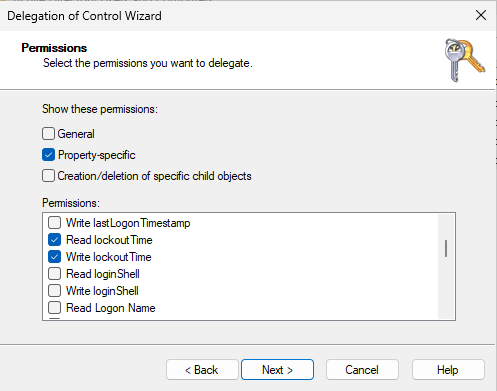

### Vérification des entrées

*View* → *Advanced Features*, puis *Properties* → *Security* → *Advanced* sur `ORG > Users` : trois entrées pour `GG_Support`, toutes limitées aux objets utilisateur descendants (*Descendant User objects*). Aucune n'est en *Full Control* ni appliquée à tous les objets.

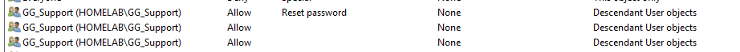

### Tests depuis PC-CLIENT01 avec `dantoine`

| Action | Attendu | Résultat |
| --- | --- | --- |
| Ouvrir ADUC | Autorisé | Console ouverte, annuaire affiché |
| Réinitialiser le mot de passe d'Alice Martin | Autorisé | « The password for Alice Martin has been changed. » |
| Débloquer un compte | Autorisé | Compte débloqué |
| Réinitialiser le mot de passe de `dantoine.adm` | Refusé | « Access is denied. » |
| Supprimer un utilisateur (`fuser`) | Refusé | « You do not have sufficient privileges… » |
| Modifier un groupe | Refusé | Refusé |
| Modifier une GPO dans GPMC | Refusé | *Edit*, *Delete* et *Rename* grisés |

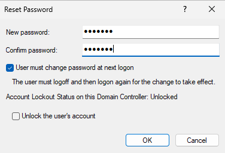

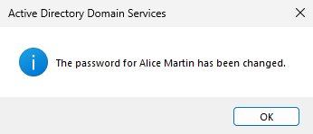

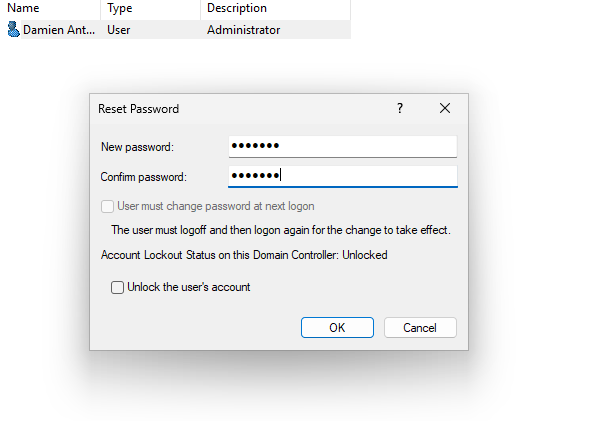

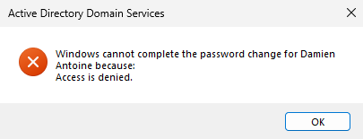

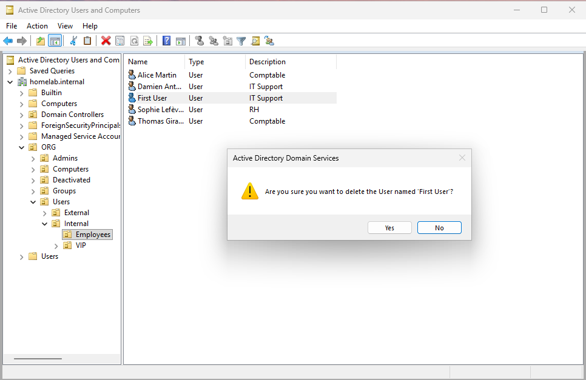

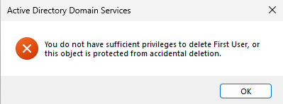

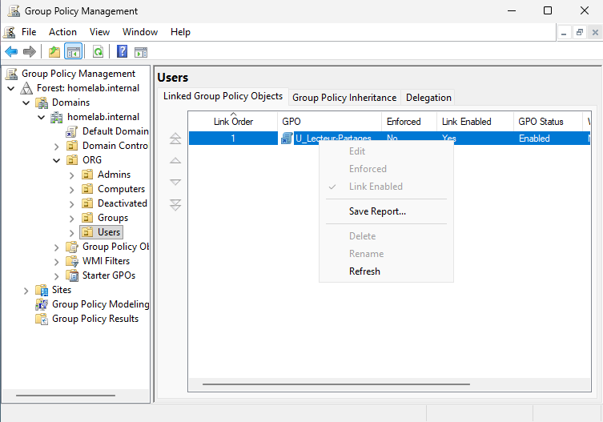

Remarques :
- Les refus ne s'affichent qu'à la validation (*OK*) : la fenêtre de réinitialisation s'ouvre normalement, même sur un compte non délégué. Un test doit aller jusqu'au bout de l'action.
- Le message de refus de suppression a deux causes possibles : droits insuffisants, ou protection contre la suppression accidentelle. Ici, `GG_Support` n'a reçu aucun droit de suppression : c'est la première.
- Le compte `dantoine.adm` est doublement protégé : il se trouve hors de l'OU déléguée, et, membre de *Domain Admins*, ses droits sont réécrits toutes les 60 minutes par le mécanisme **AdminSDHolder**, qui supprime l'héritage sur les comptes privilégiés.
- Aucune reconnexion de `dantoine` n'a été nécessaire : ses groupes n'ont pas changé, seule la liste de contrôle d'accès de l'OU a été modifiée, et elle est vérifiée par le serveur à chaque opération.

## Bureau à distance

### Les trois conditions

| Condition | Réglage |
| --- | --- |
| Le poste accepte les connexions | *Computer Configuration* → *Policies* → *Administrative Templates* → *Windows Components* → *Remote Desktop Services* → *Remote Desktop Session Host* → *Connections* → **Allow users to connect remotely by using Remote Desktop Services** = *Enabled* |
| Le pare-feu laisse passer TCP 3389 | GPO `C_Remote_Firewall` : *Computer Configuration* → *Policies* → *Administrative Templates* → *Network* → *Network Connections* → *Windows Defender Firewall* → *Domain Profile* → **Allow inbound Remote Desktop exceptions** = *Enabled*, depuis `192.168.100.10` uniquement |
| L'utilisateur a le droit de se connecter | Membres des groupes locaux *Administrators* ou *Remote Desktop Users* du poste |

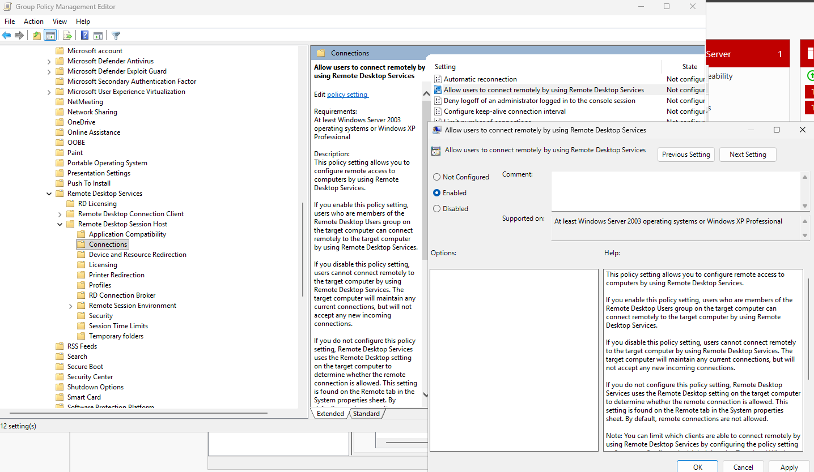

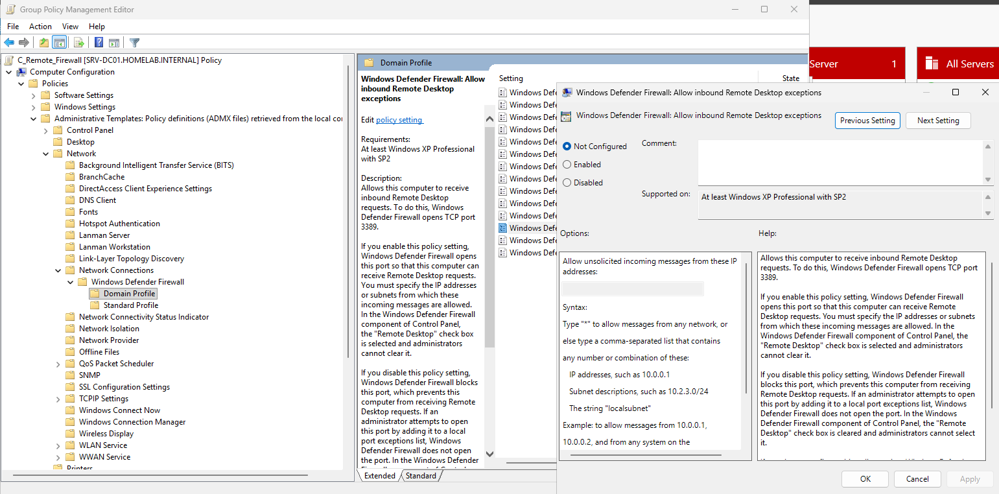

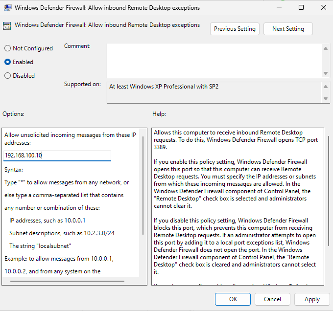

Choix :
- **Profil Domaine uniquement** : un portable connecté à un réseau extérieur passe en profil Public, où le port reste fermé.
- **Une seule adresse source** : SRV-DC01, seule autre machine du lab. En entreprise, on autoriserait le sous-réseau des postes du support : un contrôleur de domaine n'est pas un poste de travail.
- **Aucun ajout à *Remote Desktop Users*** : `GG_Support` est déjà membre du groupe local *Administrators* des postes (`C_LocalAdmin`), qui autorise le Bureau à distance. Les utilisateurs standards ne reçoivent pas ce droit.

Sur PC-CLIENT01, *Paramètres* → *Système* → *Bureau à distance* affiche l'option activée et grisée, avec la mention « Some settings are managed by your organization » : le réglage vient de la GPO.

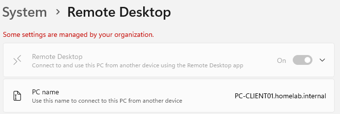

### Connexion depuis SRV-DC01

Un contrôleur de domaine n'accepte les ouvertures de session que des administrateurs : `mstsc` est lancé depuis la session d'administration de SRV-DC01, et les identifiants de `dantoine` sont saisis dans la fenêtre de connexion. Seule compte la session ouverte sur le poste distant.

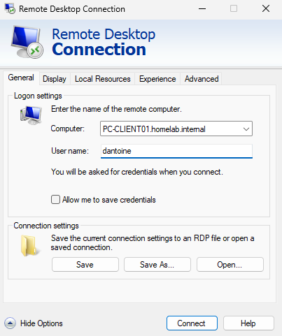

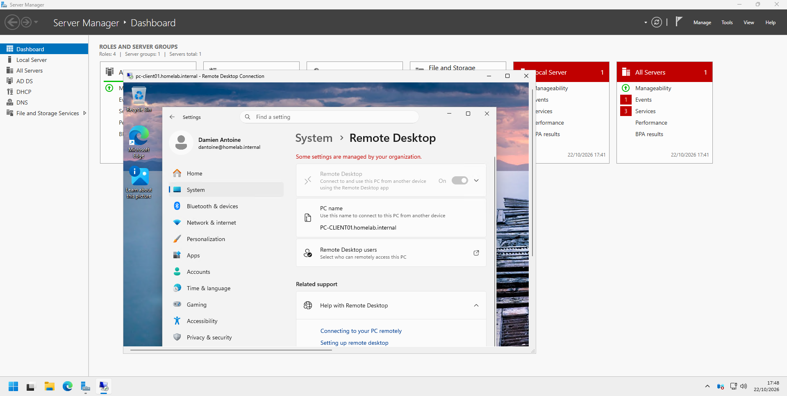

### Constat : la session de l'utilisateur est déconnectée

Quand `dantoine` se connecte alors qu'Alice a une session ouverte sur PC-CLIENT01, Alice est déconnectée. Windows 11 ne peut afficher qu'une session interactive à la fois. Sa session est **déconnectée**, pas fermée : ses applications restent ouvertes en arrière-plan et elle les retrouve à sa reconnexion.

Le Bureau à distance n'est donc pas l'outil pour dépanner un utilisateur pendant qu'il travaille :

| Outil | Principe | Usage |
| --- | --- | --- |
| **Bureau à distance** (`mstsc`) | Session propre au technicien | Poste inoccupé, administration de serveurs |
| **Assistance à distance** (`msra`) | Le technicien voit la session de l'utilisateur, avec son accord | Dépanner avec l'utilisateur, sur le réseau de l'entreprise |
| **Quick Assist** | Même principe, par code de partage, via Internet | Utilisateur hors du réseau de l'entreprise |
| **Outils centralisés** (SCCM *Remote Control*, outils tiers) | Prise en main intégrée à l'outil de gestion du parc, journalisée | Grands parcs |

## Ticket reporté

TKT-008 (compte de Thomas Girard bloqué, à traiter de bout en bout depuis PC-CLIENT01) n'a pas été traité faute de temps. Le principe est celui de [TKT-002](../tickets/tkt-002_compte-locked.md), réalisé cette fois depuis le poste du technicien avec les droits délégués. Le déverrouillage par `dantoine` a été validé lors des tests de délégation.

## Notions clés

- **RSAT** : les consoles d'administration installées sur le poste du technicien. Administrer depuis son poste plutôt que sur le contrôleur de domaine limite l'exposition du serveur le plus sensible du réseau.
- **ACL Active Directory** : chaque objet AD a ses droits, hérités de l'OU parente, et peut recevoir des droits sur une seule propriété.
- **Délégation** : droits précis posés sur une OU pour un groupe. Elle se vérifie dans *Security* → *Advanced* et se teste en priorité sur ce qui doit être refusé. L'assistant ajoute des droits mais n'en retire pas.
- **`lockoutTime`** : attribut qui marque le verrouillage d'un compte. Débloquer, c'est le remettre à zéro.
- **AdminSDHolder** : mécanisme qui réécrit régulièrement les droits des comptes et groupes privilégiés et bloque l'héritage, pour qu'une délégation ne puisse pas les atteindre.
- **Run as different user** (`Shift` + clic droit) : lancer une seule console avec le compte d'administration, sans changer de session.
- **Bureau à distance** : RDP, port TCP 3389. Trois conditions : service autorisé, pare-feu ouvert, utilisateur autorisé. Jamais exposé sur Internet ; accès par VPN ou passerelle.
- **NLA** (*Network Level Authentication*) : authentification avant la création de la session distante, activée par défaut.

## Prochaine étape

Week-end des 24–25/10 : marge. Puis ServiceNow et ITIL : création d'une instance développeur et reprise des tickets du lab dans un véritable outil de ticketing.
