# Journal — 23 octobre 2026

## Objectif de la séance

Passer des tickets rédigés en Markdown à un véritable outil de gestion des services informatiques : ServiceNow, sur une instance développeur personnelle (*Personal Developer Instance*, PDI). Préparer l'instance pour Homelab SARL, comprendre le formulaire d'incident, puis reprendre TKT-005 et TKT-006 dans l'outil.

## Réalisé

- Obtention d'une instance développeur sur developer.servicenow.com
- Création des utilisateurs du lab et des groupes d'affectation `Support N1` et `Support N2`
- Attribution du rôle d'agent `itil` par les groupes
- Exploration du formulaire d'incident : champs obligatoires, priorité, états, attente, résolution, notes
- Reprise de TKT-005 en incident (`INC0010001`)
- Création d'un article de catalogue et reprise de TKT-006 en demande de service (`REQ0010002`)
- Observation d'un SLA sur un incident

### Repères dans l'interface

- **All** : menu de navigation complet, avec un champ de filtre. Taper le nom du module (*Incident*, *Users and Groups*…) plutôt que de parcourir les menus.
- **Listes et formulaires** : une liste affiche une ligne par enregistrement, avec des filtres ; un formulaire affiche un enregistrement complet. Base commune à toutes les instances, quelle que soit la configuration du client.
- **Nom technique des tables** : `incident`, `sys_user`, `sys_user_group`. Saisir `sys_user.list` dans le filtre de *All* ouvre directement la liste.

## Préparation de l'instance

### Utilisateurs

Créés dans *Users and Groups* → *Users*, avec le même identifiant que dans Active Directory :

| User ID | Nom | Rôle dans ServiceNow |
| --- | --- | --- |
| `amartin` | Alice Martin | Demandeur, aucun rôle |
| `tgirard` | Thomas Girard | Demandeur, aucun rôle |
| `slefevre` | Sophie Lefèvre | Demandeur, aucun rôle |
| `dantoine` | Damien Antoine | Agent, rôle `itil` hérité de `Support N1` |

- **Aucun mot de passe** n'est défini pour les demandeurs : leur point de vue est vérifié par usurpation d'identité (*Impersonate user*) depuis le compte `admin`.

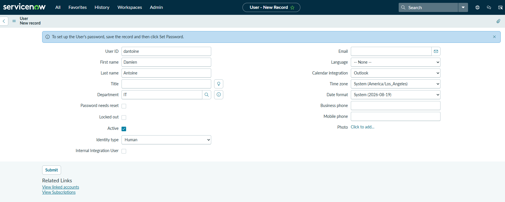

### Groupes et rôles

| Notion ServiceNow | Rôle | Équivalent dans le lab |
| --- | --- | --- |
| **Group** | Équipe et file d'attente : un ticket est affecté à un groupe, puis à un de ses membres | `GG_Support` |
| **Role** | Droit dans l'outil | Délégation sur l'OU `ORG > Users` |

| Groupe | Membres | Rôle |
| --- | --- | --- |
| `Support N1` | Damien Antoine | `itil` |
| `Support N2` | aucun | `itil` |

- Le rôle `itil` est le rôle standard des agents ITSM (*fulfillers*) : créer, affecter, traiter et résoudre incidents, problèmes, changements et demandes, sans accès à l'administration de l'instance. En entreprise, il correspond à une licence d'agent payante ; les demandeurs n'ont aucun rôle.
- Rôles écartés : `agent_security_admin`, rôle d'administration bien trop large pour un agent ; `agent_workspace_user`, simple accès à l'interface *Workspace*, sans droit de traitement.
- Le rôle est attribué au **groupe**, pas à l'utilisateur : les membres en héritent. Même logique qu'AGDLP : un arrivant ou un départ ne modifie que les membres du groupe.
- `Support N2` reste vide : il sert de destination pour les escalades. La différence entre niveaux se fait par l'affectation des tickets, pas par des droits plus larges.

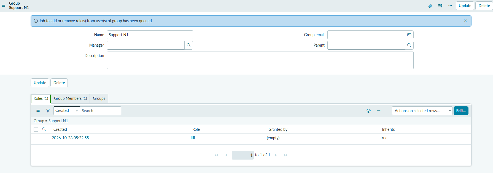

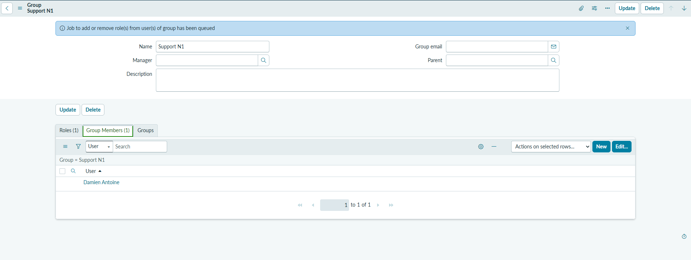

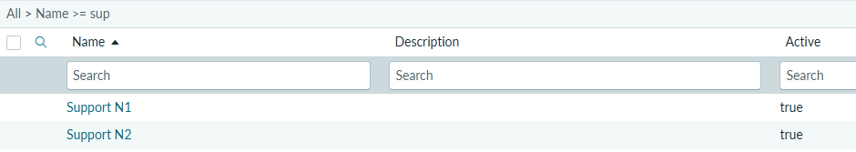

### Vérification du compte d'agent

Usurpation d'identité de `dantoine` depuis `admin` : les incidents sont accessibles, les pages d'administration de l'instance sont refusées (« Security constraints prevent access to requested page »).

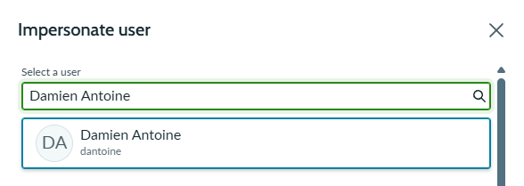

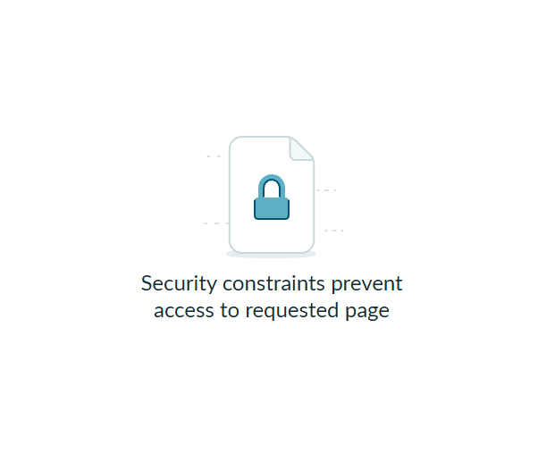

## Le formulaire d'incident

| Question | Constat |
| --- | --- |
| Champs obligatoires | *Caller* et *Short description*. Le numéro est attribué automatiquement |
| Priorité | Calculée à partir de l'impact et de l'urgence par une table de correspondance configurable. Le champ est en lecture seule |
| États | *New* → *In Progress* → *On Hold* → *Resolved* → *Closed* ; *Canceled* possible à tout moment |
| Passage en *On Hold* | Une raison d'attente est obligatoire (*Awaiting Caller*, *Awaiting Vendor*…) |
| Passage en *Resolved* | Code de résolution et notes de résolution obligatoires |
| *Additional comments* | Visibles par le demandeur, qui les reçoit en général par e-mail |
| *Work notes* | Notes internes, visibles par tous les agents ayant accès au ticket, pas par le demandeur |

Matrice de priorité par défaut de ServiceNow :

| Impact ↓ / Urgence → | 1 - High | 2 - Medium | 3 - Low |
| --- | --- | --- | --- |
| **1 - High** | 1 - Critical | 2 - High | 3 - Moderate |
| **2 - Medium** | 2 - High | 3 - Moderate | 4 - Low |
| **3 - Low** | 3 - Moderate | 4 - Low | 5 - Planning |

*Closed* n'est pas proposé à l'agent : il **résout**, et le ticket passe en *Closed* automatiquement après un délai configurable, sauf si le demandeur signale que le problème persiste. C'est le principe ITIL : seul le demandeur confirme que le service est rétabli.

Règle de rédaction : ce qui est technique, une hypothèse ou une information sensible va dans les *Work notes* ; ce que l'utilisateur doit savoir va dans les *Additional comments*.

## TKT-005 dans ServiceNow : `INC0010001`

| Champ | Valeur |
| --- | --- |
| Caller | Thomas Girard |
| Impact / Urgence / Priorité | 3 - Low / 2 - Medium / 4 - Low |
| Assignment group / Assigned to | Support N1 / Damien Antoine |
| Short description | Accès refusé au dossier Compta après ajout au groupe Compta. |
| Resolution code | Solution provided |
| Resolution notes | Thomas devait fermer et rouvrir sa session pour que la modification de groupe soit prise en compte. |

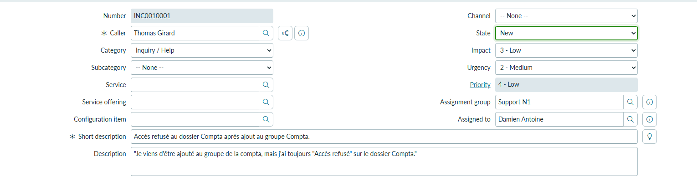

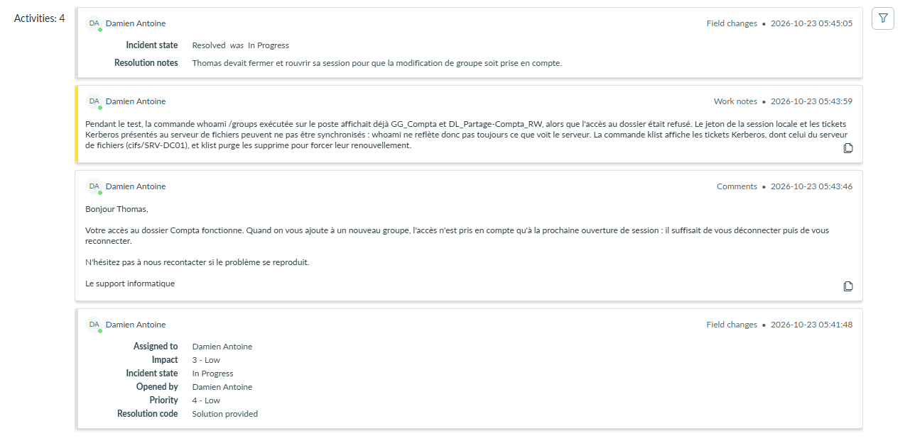

L'historique contient le passage en *In Progress*, une note interne, un message au demandeur et la résolution.

### SLA

L'onglet *Task SLAs* de l'incident affiche la définition de démonstration **Priority 4 resolution (2 day)** : objectif de résolution, temps restant de 2 jours, temps écoulé et pourcentage, heure de début.

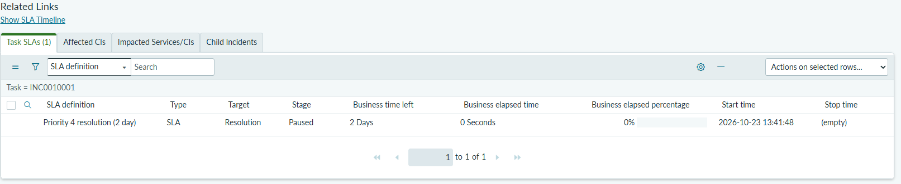

- Le SLA est à l'étape *Paused* : l'incident est résolu, et la définition suspend le compteur, qui ne s'arrête définitivement qu'à la clôture. Si l'utilisateur rouvre le ticket, le compteur reprend où il en était.
- Le temps écoulé est compté en **temps ouvré** (*Business elapsed time*), selon le calendrier de travail associé à la définition : les heures hors calendrier ne sont pas décomptées.
- Les définitions de démonstration sont rattachées à une priorité : un incident change de SLA quand sa priorité change.

## TKT-006 dans ServiceNow : `REQ0010002`

Un accès temporaire à un dossier n'est pas un incident : rien n'est en panne, l'utilisatrice demande un service. Il passe donc par le **catalogue de services**.

| Enregistrement | Préfixe | Rôle |
| --- | --- | --- |
| Request | `REQ` | La demande globale |
| Requested Item | `RITM` | Un article demandé ; c'est là que se font les validations |
| Catalog Task | `SCTASK` | Le travail concret confié à une équipe |

### Article de catalogue

Aucun article de démonstration ne correspondait. Création avec *Catalog Builder* de l'article **AD - Request folder access**, dans le catalogue *Service Catalog* :

| Question | Type | Nom technique |
| --- | --- | --- |
| Which folder would you like to be able to have access to ? | Texte, une ligne | `folder_name` |
| How long do you need the access for ? | Durée | `access_duration` |

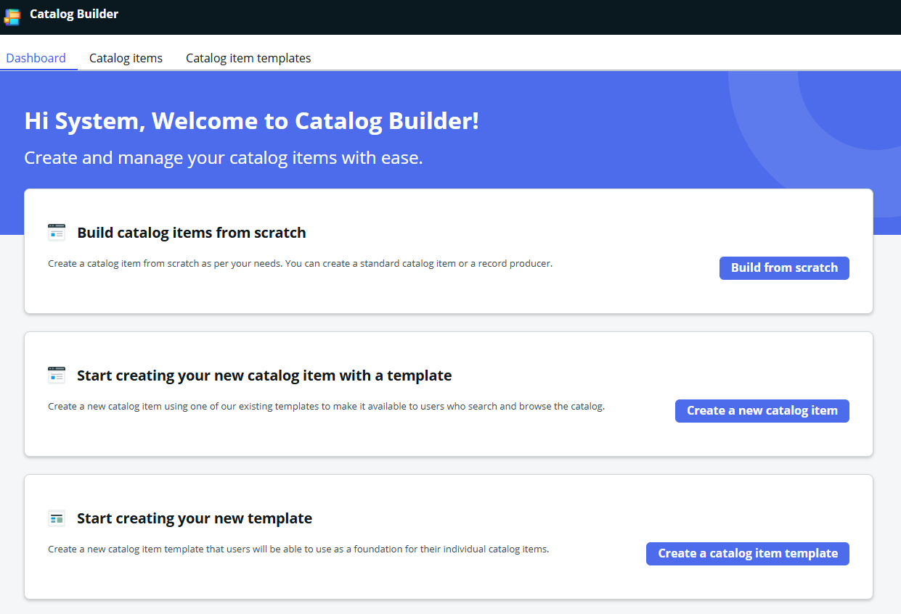

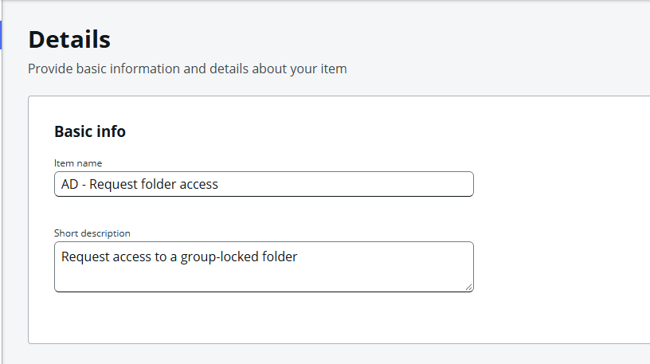

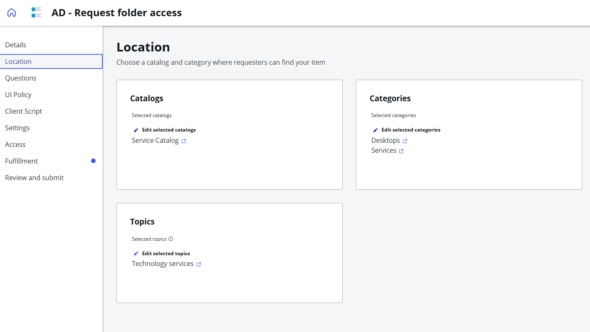

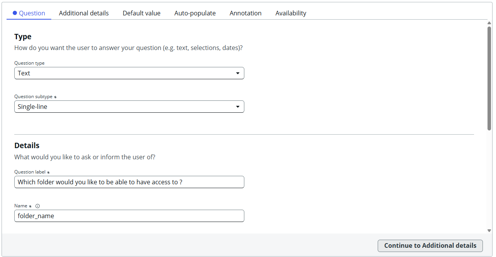

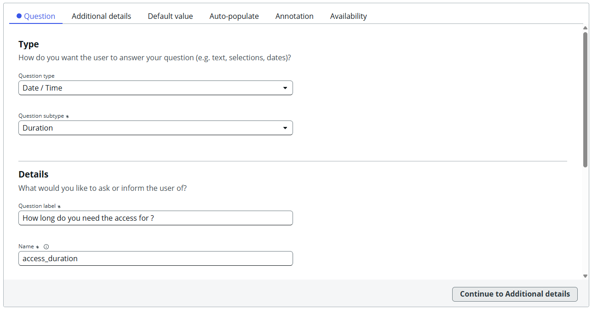

### Demande de Sophie

Commande passée au nom de Sophie Lefèvre, par usurpation de son identité : dossier `Compta`, durée 30 jours.

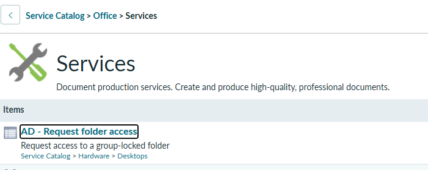

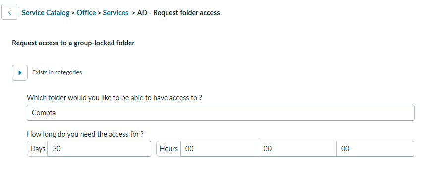

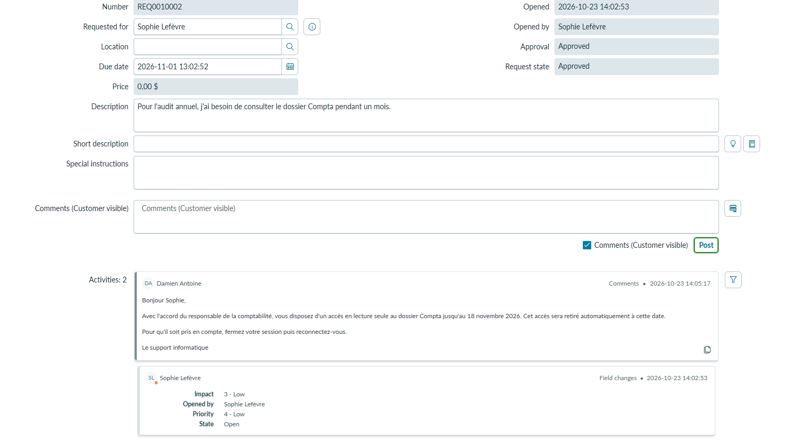

La demande a reçu un message au demandeur reprenant celui de TKT-006.

Concevoir le catalogue revient aux administrateurs ServiceNow et aux responsables de processus. Le support, premier à recevoir des demandes incomplètes, fait remonter les défauts des formulaires.

## Notions clés

- **ITSM** : gestion des services informatiques. ServiceNow en est l'outil le plus répandu dans les grandes entreprises.
- **Incident et demande de service** : un incident est une interruption ou une dégradation d'un service ; une demande de service est une requête standard (accès, matériel, information). Ils suivent des circuits différents dans l'outil.
- **Groupe d'affectation** : file d'attente d'une équipe. L'escalade consiste à réaffecter le ticket au groupe de niveau supérieur.
- **Rôle `itil`** : rôle des agents, attribué par groupe.
- **Priorité** : calculée par la matrice impact × urgence, non modifiable à la main.
- **Résolu et Clos** : l'agent résout, la clôture intervient après confirmation ou délai.
- **Work notes et Additional comments** : interne et visible par le demandeur.
- **SLA** : objectif de délai mesuré sur chaque ticket, en temps ouvré, suspendu pendant certaines attentes et à la résolution.
- **REQ, RITM, SCTASK** : les trois niveaux d'une demande de service.
- **Usurpation d'identité** (*Impersonate*) : vérifier ce que voit un utilisateur sans connaître son mot de passe.

## Prochaine étape

Scénarios de support en conditions réelles (26–28/10) : appels d'utilisateurs simulés, tickets créés et traités dans ServiceNow, diagnostic et résolution dans le lab, escalade vers `Support N2`.
