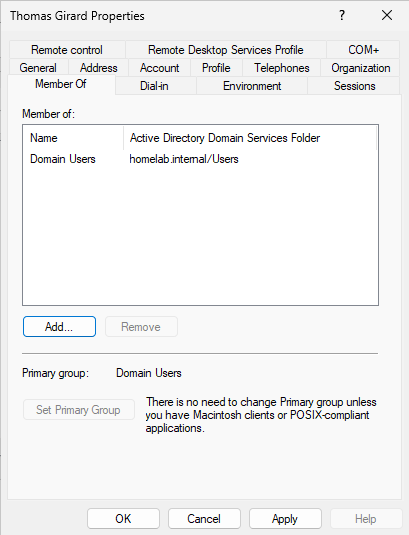
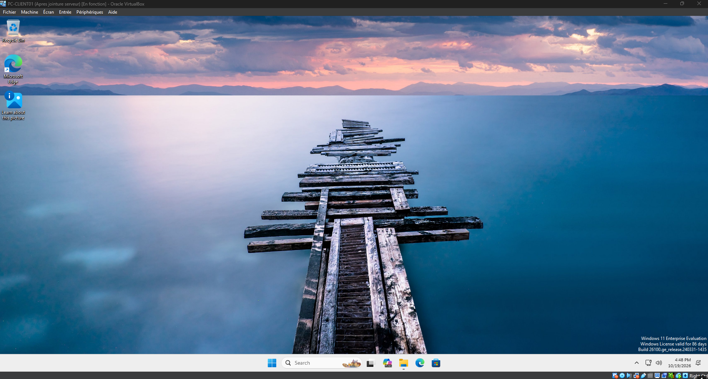
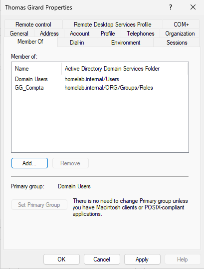
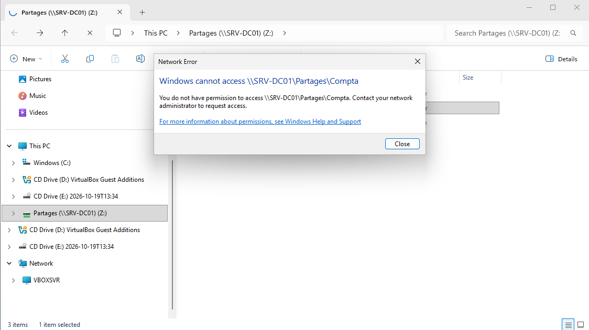
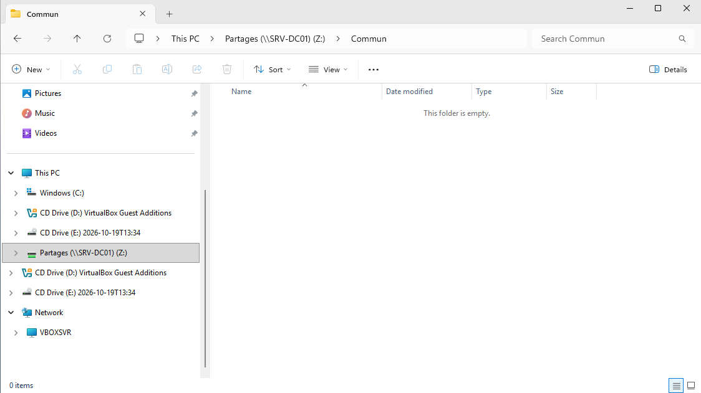
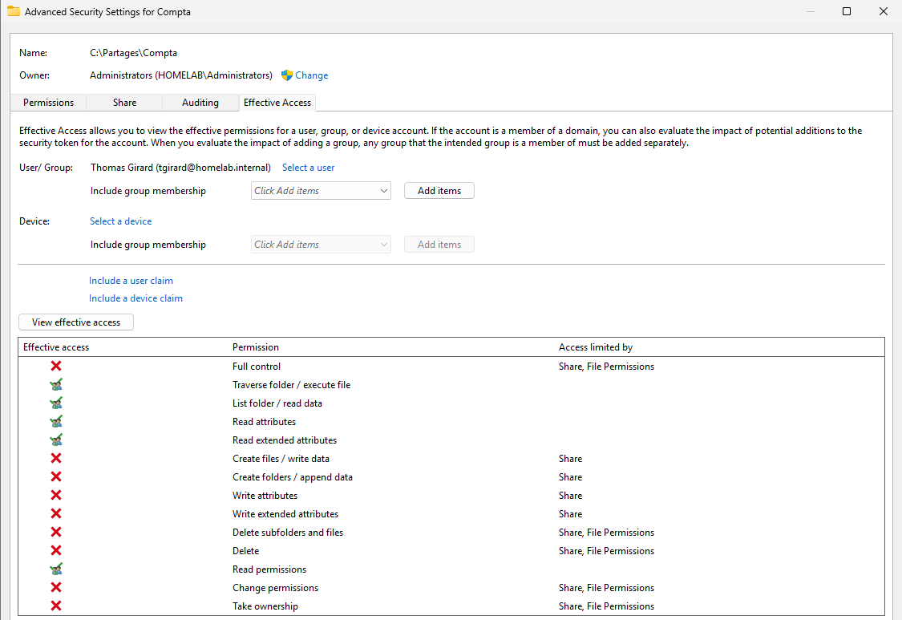
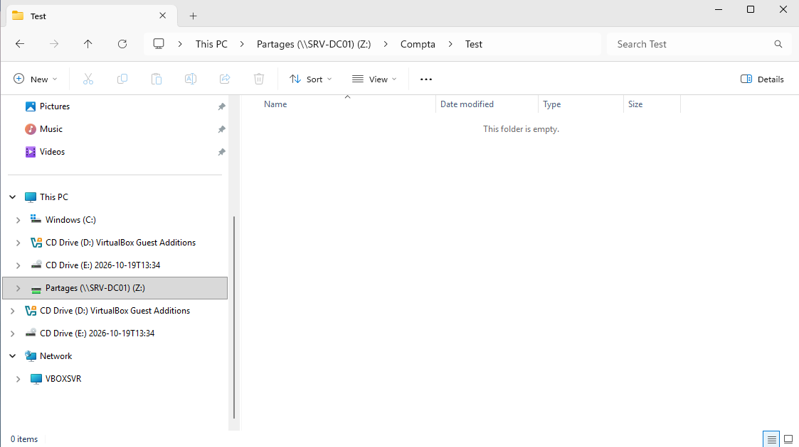

# TKT-005 — Accès refusé au dossier Compta après ajout au groupe

| Champ | Valeur |
| --- | --- |
| Type | Incident |
| Demandeur | Thomas Girard (Comptabilité) |
| Date d'ouverture | 19/10/2026 |
| Date de clôture | 19/10/2026 |
| Priorité | Moyenne (impact faible : un seul utilisateur ; urgence moyenne : il ne peut pas accéder à ses fichiers de travail) |
| Statut | Clos |

## Description
Je viens d'être ajouté au groupe de la compta, mais j'ai toujours « Accès refusé » sur le dossier Compta.

## Reproduction
1. Retrait de Thomas Girard du groupe `GG_Compta`.
2. Ouverture de session de Thomas sur PC-CLIENT01.
3. Ajout de Thomas à `GG_Compta` pendant que sa session est ouverte.
4. Tentative d'ouverture de `\\SRV-DC01\Partages\Compta`.

## Diagnostic
- **Côté poste** : accès refusé à `Compta`. L'accès à `Commun` fonctionne : le poste joint bien le serveur et le partage.
- **Côté Active Directory** : Thomas est bien membre de `GG_Compta`, lui-même membre de `DL_Partage-Compta_RW`.
- **Côté serveur** : l'onglet *Effective Access* du dossier `Compta`, pour l'utilisateur `tgirard`, montre que l'accès en lecture lui est accordé.
- **Conclusion** : le serveur et l'annuaire autorisent l'accès, mais la session de Thomas ne le reflète pas. Son appartenance au groupe n'est pas prise en compte par la session en cours.

## Cause
Les groupes d'un utilisateur sont inscrits dans son jeton de session et dans ses tickets Kerberos au moment de l'ouverture de session. Un groupe ajouté pendant la session n'est pas pris en compte tant que l'utilisateur ne s'est pas reconnecté.

## Suivi

### 19/10/2026 — Résolution

**Actions :**
- Demande à l'utilisateur de fermer complètement sa session (*Sign out*), puis de se reconnecter.

**Vérification :**
- Accès au dossier `Compta` et à son contenu.

**Statut :** Clos

## Observation
Pendant le test, la commande `whoami /groups` exécutée sur le poste affichait déjà `GG_Compta` et `DL_Partage-Compta_RW`, alors que l'accès au dossier était refusé. Le jeton de la session locale et les tickets Kerberos présentés au serveur de fichiers peuvent ne pas être synchronisés : `whoami` ne reflète donc pas toujours ce que voit le serveur. La commande `klist` affiche les tickets Kerberos, dont celui du serveur de fichiers (`cifs/SRV-DC01`), et `klist purge` les supprime pour forcer leur renouvellement.

## Message de clôture

> Bonjour Thomas,
>
> Votre accès au dossier Compta fonctionne. Quand on vous ajoute à un nouveau groupe, l'accès n'est pris en compte qu'à la prochaine ouverture de session : il suffisait de vous déconnecter puis de vous reconnecter.
>
> N'hésitez pas à nous recontacter si le problème se reproduit.
>
> Le support informatique

## Leçon retenue
- Après l'ajout d'un utilisateur à un groupe, toujours lui demander de fermer puis rouvrir sa session. Un simple verrouillage de l'écran ne suffit pas.
- Comparer ce que dit le serveur (*Effective Access*) et ce que vit l'utilisateur permet de localiser rapidement le problème : ici, les droits étaient corrects, seule la session était en retard.
- Prévenir l'utilisateur au moment de l'ajout évite le ticket : « Votre accès sera actif à votre prochaine connexion. »
