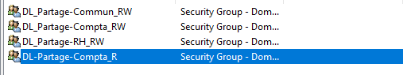
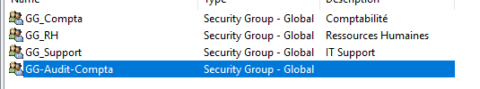
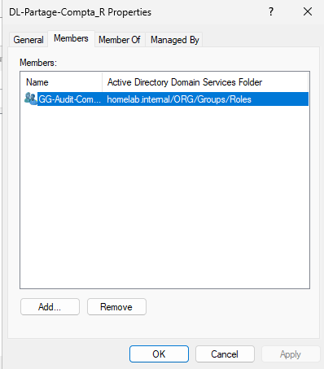
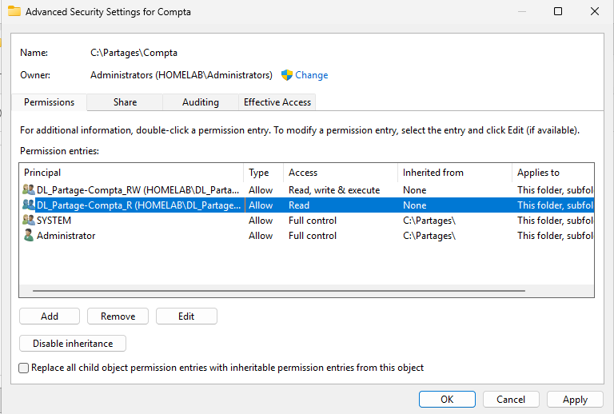
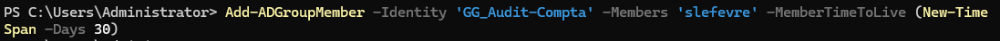
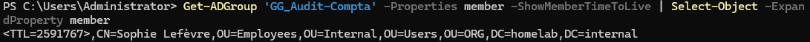
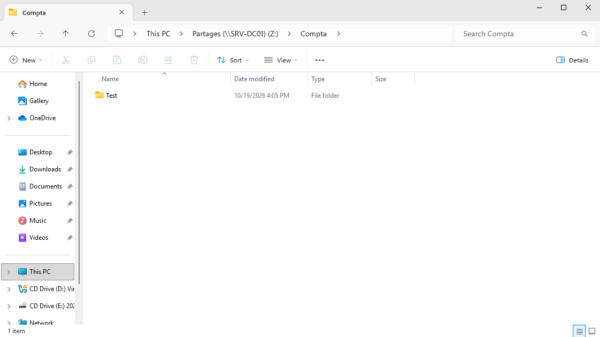

# TKT-006 — Accès temporaire au dossier Compta pour l'audit annuel

| Champ | Valeur |
| --- | --- |
| Type | Demande de service |
| Demandeur | Sophie Lefèvre (RH) |
| Bénéficiaire | Sophie Lefèvre (RH) |
| Date d'ouverture | 19/10/2026 |
| Date de fin d'accès | 18/11/2026 (retrait automatique) |
| Priorité | Basse (demande planifiée, aucun utilisateur bloqué) |
| Statut | En attente (accès actif jusqu'au 18/11/2026) |

## Description
Pour l'audit annuel, j'ai besoin de consulter le dossier Compta pendant un mois.

## Diagnostic
- La demande porte sur les données d'un autre service : la décision appartient au responsable de la comptabilité, propriétaire des données. Validation demandée et obtenue (simulée dans le cadre du lab).
- Besoin : **lecture seule**, pour une durée de **30 jours**.
- Options écartées :
  - ajouter `GG_RH` aux droits de `Compta` : tout le service RH aurait obtenu l'accès ;
  - ajouter Sophie directement dans les droits du dossier ou dans un groupe domaine local : contraire à AGDLP, et difficile à suivre dans le temps.
- Solution retenue : un groupe de rôle dédié à l'audit, imbriqué dans un groupe de permission en lecture seule, avec une appartenance limitée dans le temps.

## Suivi

### 19/10/2026 — Mise en place de l'accès

**Actions :**
1. Création du groupe domaine local `DL-Partage-Compta_R`, pour la lecture seule du dossier `Compta`.
2. Création du groupe global `GG-Audit-Compta`, membre de `DL-Partage-Compta_R`.
3. Ajout d'une entrée en lecture sur le dossier `Compta`, appliquée au dossier, à ses sous-dossiers et à ses fichiers.
4. Activation de la fonctionnalité *Privileged Access Management* de la forêt (changement documenté dans le journal du 19/10/2026).
5. Ajout de Sophie Lefèvre au groupe pour 30 jours :

```powershell
Add-ADGroupMember -Identity 'GG_Audit-Compta' -Members 'slefevre' -MemberTimeToLive (New-TimeSpan -Days 30)
```











**Vérification :**
- Durée restante de l'appartenance, consultable uniquement en PowerShell :

```powershell
Get-ADGroup 'GG_Audit-Compta' -Properties member -ShowMemberTimeToLive | Select-Object -ExpandProperty member
```

```
<TTL=2591767>,CN=Sophie Lefèvre,OU=Employees,OU=Internal,OU=Users,OU=ORG,DC=homelab,DC=internal
```

2 591 767 secondes, soit 30 jours.

- Sophie accède au dossier `Compta` en lecture depuis PC-CLIENT01.





**Message au demandeur :**

> Bonjour Sophie,
>
> Avec l'accord du responsable de la comptabilité, vous disposez d'un accès en lecture seule au dossier Compta jusqu'au 18 novembre 2026. Cet accès sera retiré automatiquement à cette date.
>
> Pour qu'il soit pris en compte, fermez votre session puis reconnectez-vous.
>
> Le support informatique

**Statut :** En attente (fin d'accès le 18/11/2026)

## Leçon retenue
- Un accès à des données d'un autre service se valide avec le **propriétaire des données**, pas seulement avec le demandeur.
- Un groupe dédié au besoin (ici l'audit) permet de retirer l'accès sans affecter personne d'autre, et de le réutiliser l'année suivante.
- L'appartenance temporaire (`-MemberTimeToLive`) retire automatiquement l'utilisateur du groupe, et les tickets Kerberos délivrés sont limités à la durée restante : l'accès ne survit pas à l'expiration.
- Cette appartenance n'apparaît pas dans les consoles graphiques : elle doit impérativement être documentée dans le ticket.
- L'activation de *Privileged Access Management* est irréversible : en entreprise, c'est une décision d'architecture, à prendre avant de traiter un ticket.
