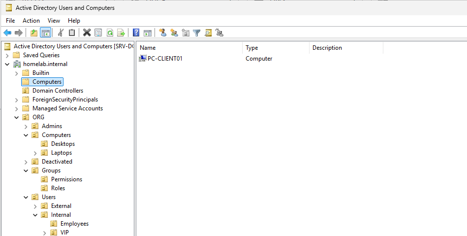
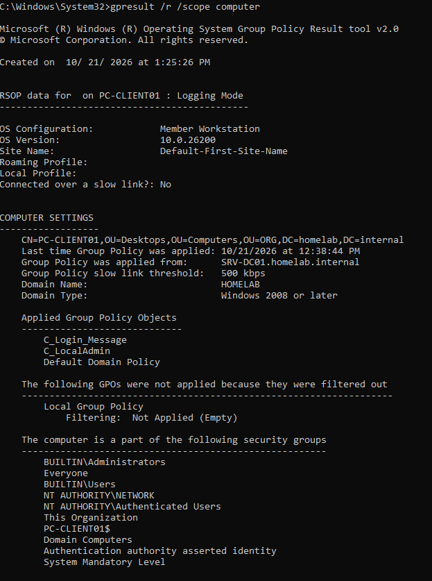
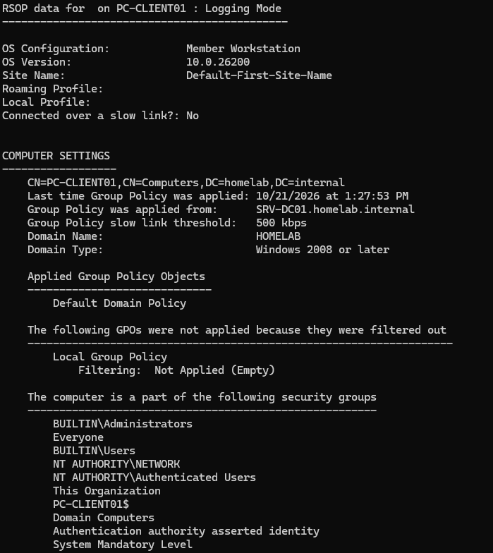
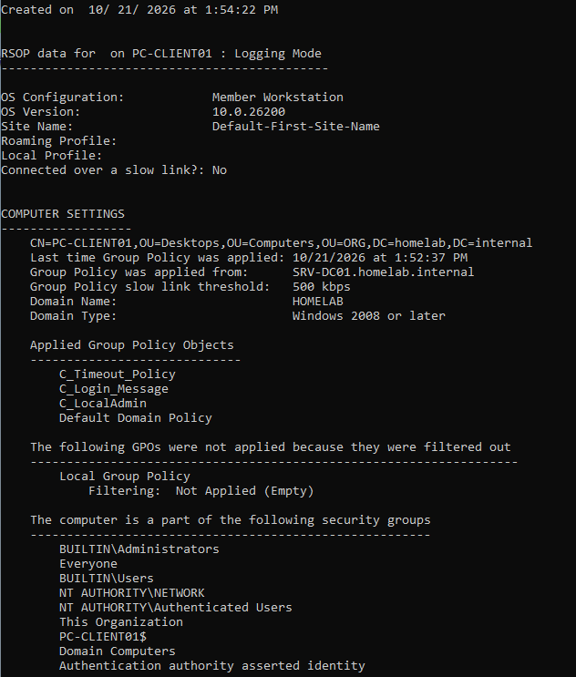

# TKT-007 — Le poste ne se verrouille jamais automatiquement

| Champ | Valeur |
| --- | --- |
| Type | Incident |
| Demandeur | Alice Martin (Comptabilité) |
| Poste | PC-CLIENT01 |
| Date d'ouverture | 21/10/2026 |
| Date de clôture | 21/10/2026 |
| Priorité | Moyenne (impact faible : un seul poste ; urgence moyenne : l'utilisateur peut travailler, mais le poste n'est pas conforme à la politique de sécurité) |
| Statut | Clos |

## Description
Mon PC ne se verrouille jamais tout seul, alors que celui de mon collègue oui.

## Reproduction
Déplacement de l'objet ordinateur PC-CLIENT01 de `ORG > Computers > Desktops` vers le conteneur `Computers` par défaut, à la racine du domaine, puis application des stratégies sur le poste.



## Diagnostic
- **Côté utilisateur** : le symptôme concerne un seul poste, alors que les postes de ses collègues se verrouillent. La cause est donc à chercher sur ce poste, pas dans la GPO elle-même.
- **Côté poste** : `gpresult /r /scope computer`, dans une invite de commandes élevée, comparé à la sortie d'un poste conforme.

Poste conforme (avant déplacement) :
```
COMPUTER SETTINGS
    CN=PC-CLIENT01,OU=Desktops,OU=Computers,OU=ORG,DC=homelab,DC=internal

    Applied Group Policy Objects
    -----------------------------
        C_Login_Message
        C_LocalAdmin
        Default Domain Policy
```

Poste d'Alice (après déplacement) :
```
COMPUTER SETTINGS
    CN=PC-CLIENT01,CN=Computers,DC=homelab,DC=internal

    Applied Group Policy Objects
    -----------------------------
        Default Domain Policy
```





- **Conclusion** : seule la *Default Domain Policy* s'applique. Toutes les GPO `C_` liées à `ORG > Computers` ont disparu. La première ligne de `COMPUTER SETTINGS` montre pourquoi : l'objet ordinateur n'est plus dans l'OU `Desktops`, mais dans `CN=Computers`.

## Cause
`Computers`, à la racine du domaine, est un **conteneur** et non une unité d'organisation : aucune GPO ne peut y être liée. Un poste qui s'y trouve ne reçoit que les GPO liées au domaine, et donc aucune des stratégies des postes de travail.

En situation réelle, un poste arrive dans ce conteneur sans que personne ne l'y place : c'est l'emplacement par défaut de tout ordinateur joint au domaine sans objet créé à l'avance. Si le technicien oublie ensuite de le déplacer dans la bonne OU, le poste fonctionne normalement, mais sans les stratégies de l'entreprise.

## Suivi

### 21/10/2026 — Résolution

**Actions :**
1. Déplacement de PC-CLIENT01 dans `ORG > Computers > Desktops`.
2. Redémarrage du poste : la partie ordinateur des GPO s'applique au démarrage, et le verrouillage après inactivité n'est pris en compte qu'après un redémarrage.

**Vérification :**
- `gpresult /r /scope computer` : les trois GPO des postes sont de nouveau appliquées.

```
COMPUTER SETTINGS
    CN=PC-CLIENT01,OU=Desktops,OU=Computers,OU=ORG,DC=homelab,DC=internal
    Last time Group Policy was applied: 10/21/2026 at 1:52:37 PM

    Applied Group Policy Objects
    -----------------------------
        C_Timeout_Policy
        C_Login_Message
        C_LocalAdmin
        Default Domain Policy
```

- Session laissée inactive 10 minutes : la session se verrouille.



**Statut :** Clos

## Observation
Lors de la reproduction, la GPO de verrouillage n'était pas encore fonctionnelle : ses réglages avaient été placés dans la partie utilisateur d'une GPO liée à une OU d'ordinateurs (détail dans le [journal du 21/10/2026](../journal/2026-10-21.md)). L'absence de verrouillage observée à ce moment-là ne prouvait donc rien à elle seule. Le diagnostic repose sur la comparaison des sorties de `gpresult`, qui montrent la perte de toutes les GPO `C_` dès que le poste quitte l'OU `Desktops`.

## Message de clôture

> Bonjour Alice,
>
> Votre poste n'était pas rangé au bon endroit dans notre annuaire : il ne recevait donc pas les réglages de sécurité de l'entreprise, dont le verrouillage automatique. C'est corrigé. Votre session se verrouillera désormais après 10 minutes d'inactivité, comme celles de vos collègues.
>
> Pensez à verrouiller votre poste vous-même quand vous vous absentez (touches Windows + L).
>
> Le support informatique

## Leçon retenue
- Quand un réglage ne s'applique que sur un poste, comparer `gpresult` avec celui d'un poste conforme. La première ligne indique l'emplacement de l'objet dans l'annuaire, souvent la cause.
- Après chaque jonction au domaine, vérifier que le poste est dans la bonne OU.
- Deux façons d'éviter le problème pour les futurs postes :
  - **créer l'objet ordinateur à l'avance** dans la bonne OU, comme pour PC-CLIENT01 lors de son installation ;
  - **rediriger l'emplacement par défaut** des nouveaux ordinateurs avec `redircmp "OU=Desktops,OU=Computers,OU=ORG,DC=homelab,DC=internal"` (équivalent pour les utilisateurs : `redirusr`).
- `gpresult` sur la partie ordinateur demande une invite de commandes élevée.
