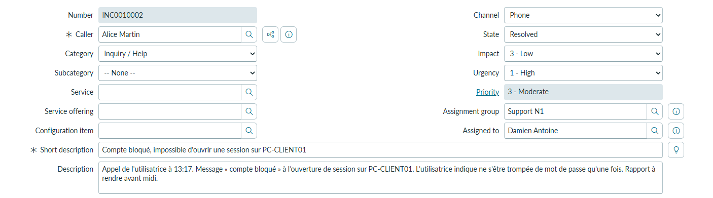
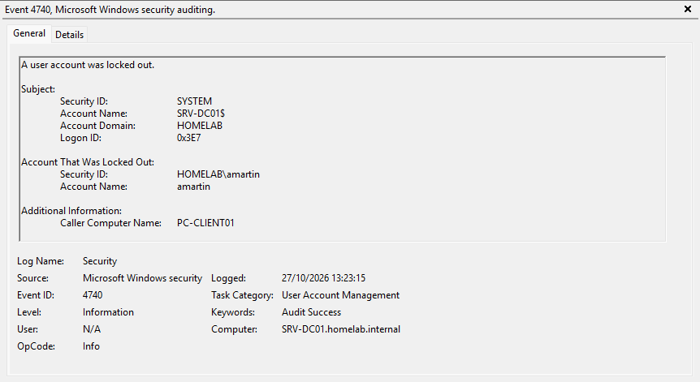
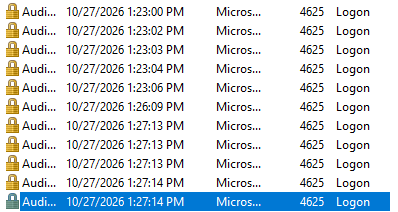
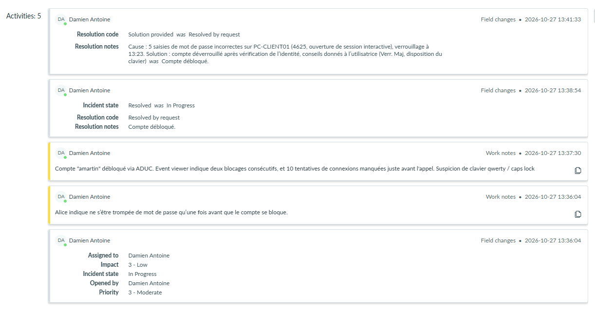

# TKT-008 — Compte bloqué, impossible d'ouvrir une session

| Champ | Valeur |
| --- | --- |
| Type | Incident |
| Référence ServiceNow | INC0010002 |
| Demandeur | Alice Martin (Comptabilité) |
| Poste | PC-CLIENT01 |
| Canal | Téléphone |
| Date d'ouverture | 27/10/2026 |
| Date de résolution | 27/10/2026 |
| Priorité | 3 - Moderate (impact faible : un seul utilisateur ; urgence haute : elle ne peut pas travailler et doit rendre un rapport avant midi) |
| Statut | Résolu |

## Description
Appel de l'utilisatrice : elle ne peut plus ouvrir de session, le mot de passe est refusé, puis un message indique que le compte est bloqué. Elle affirme connaître son mot de passe et ne s'être trompée qu'une fois. Rapport à rendre avant midi.

## Prise en charge
- Identification de l'appelante : nom, identifiant `amartin`, poste PC-CLIENT01 (étiquette sur l'unité centrale).
- Vérification de l'identité avant toute action : numéro de l'appelant comparé à celui de l'annuaire.
- Compte déverrouillé dans *Active Directory Users and Computers* : *Properties* → *Account* → *Unlock account*. L'utilisatrice confirme pendant l'appel que la session s'ouvre.

## Diagnostic
Un verrouillage nécessite 5 échecs en 10 minutes (stratégie du domaine). L'utilisatrice déclarant une seule erreur, la source des échecs a été recherchée.

- **Contrôleur de domaine** : événement 4740, verrouillage de `amartin` à 13:23:15, *Caller Computer Name* : `PC-CLIENT01`. Les tentatives viennent de son propre poste : téléphone, autre poste et accès distant sont écartés.
- **Poste** : événements 4625 (échec d'ouverture de session) sur PC-CLIENT01 :
  - 5 échecs entre 13:23:00 et 13:23:06, juste avant le verrouillage ;
  - de nouveaux échecs à 13:26:09, puis entre 13:27:13 et 13:27:14, alors que le compte était déjà bloqué.

Les échecs ont été saisis sur le poste de l'utilisatrice, en rafale, avant le verrouillage. Les tentatives suivantes correspondent à son récit : elle a continué d'essayer, puis a appelé en voyant le message de blocage.

## Cause
Plusieurs saisies de mot de passe incorrectes sur PC-CLIENT01. Hypothèse : touche Verr. Maj activée ou disposition du clavier modifiée (QWERTY), l'utilisatrice tapant de bonne foi son mot de passe.

## Suivi

### 27/10/2026 — Résolution

**Actions :**
- Déverrouillage du compte après vérification de l'identité.
- Recherche de la source des échecs (4740 sur SRV-DC01, 4625 sur PC-CLIENT01).
- Conseils donnés par téléphone : vérifier Verr. Maj et la langue du clavier, verrouiller le poste en cas d'absence (Windows + L).

**Notes de résolution (ServiceNow) :**
> Cause : 5 saisies de mot de passe incorrectes sur PC-CLIENT01 (4625, ouverture de session interactive), verrouillage à 13:23. Solution : compte déverrouillé après vérification de l'identité, conseils donnés à l'utilisatrice (Verr. Maj, disposition du clavier).

**Code de résolution :** Solution provided

**Statut :** Résolu

## Message de clôture
Résolution confirmée par téléphone pendant l'appel ; aucun message écrit n'a été ajouté au ticket.

## Leçon retenue
- Déverrouiller ne suffit pas : sans recherche de la cause, le compte risque de se bloquer de nouveau.
- L'événement 4740 indique **d'où** viennent les tentatives ; les 4625 du poste indiquent **quand** et **comment**.
- Ce que dit l'utilisateur est une piste, pas une preuve. Une contradiction avec les journaux n'est pas un mensonge : on rédige les faits, sans accusation.
- Pour une vérification d'identité plus sûre que le numéro affiché : rappeler l'utilisateur sur le numéro de l'annuaire.
- Des tentatives depuis un poste que l'utilisateur n'utilise pas, ou en dehors de ses horaires, relèveraient d'un incident de sécurité, à escalader.
