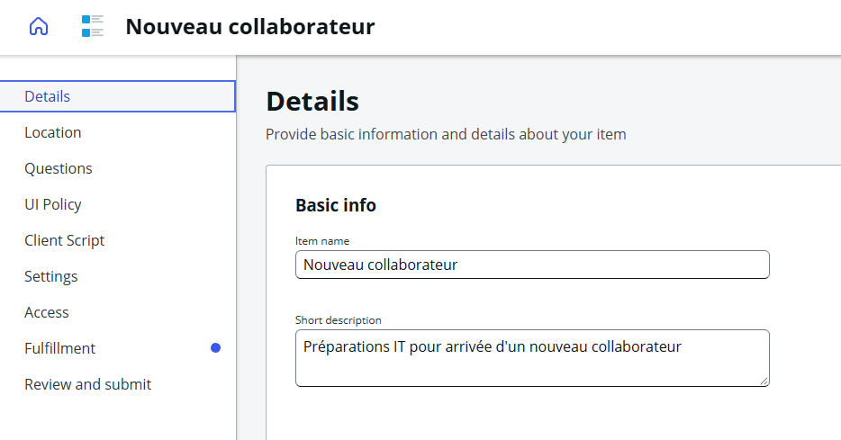
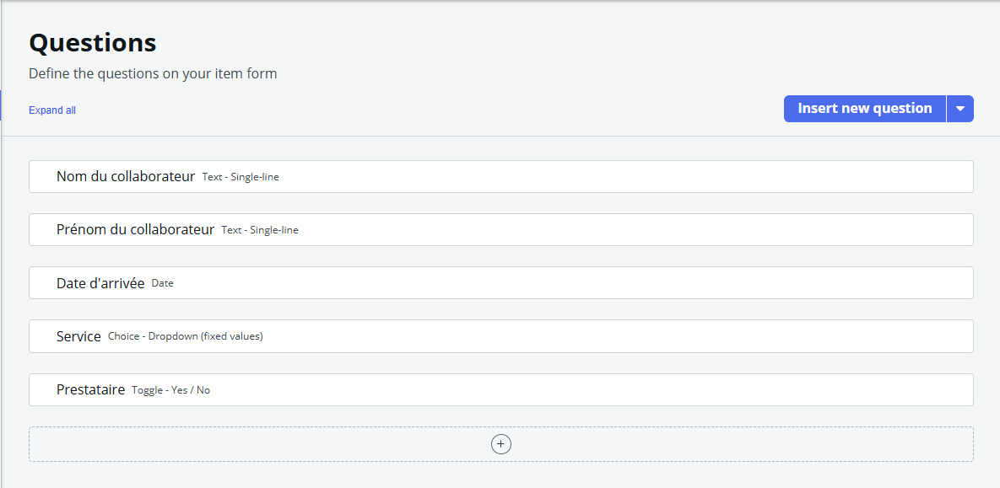
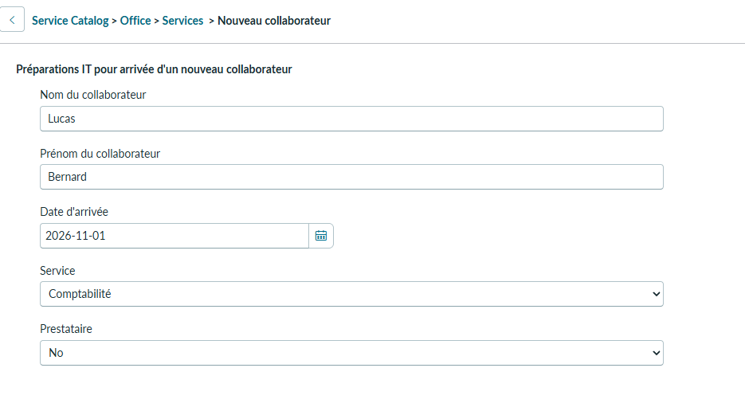
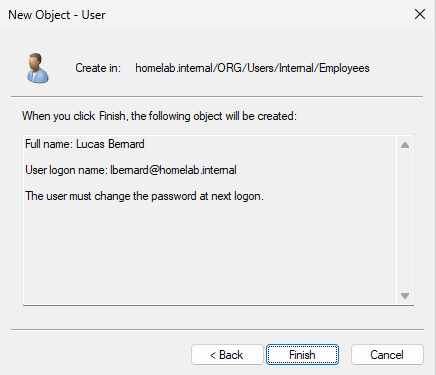

# TKT-009 — Arrivée d'un nouveau collaborateur à la comptabilité

| Champ | Valeur |
| --- | --- |
| Type | Demande de service |
| Référence ServiceNow | REQ0010003 / RITM0010003 |
| Demandeur | Sophie Lefèvre (RH) |
| Bénéficiaire | Lucas Bernard (Comptabilité, CDI) |
| Canal | Téléphone |
| Date d'ouverture | 27/10/2026 |
| Date d'arrivée du collaborateur | 02/11/2026, 9 h |
| Statut | En cours : compte créé ; poste de travail et ligne téléphonique transmis |

## Description
Appel des RH : un nouveau comptable arrive lundi 2 novembre à 9 heures. Il a besoin d'un compte, d'un ordinateur, d'une ligne téléphonique, et des mêmes accès que les autres comptables. L'accueil est assuré par la demandeuse, qui souhaite que tout soit prêt à son arrivée.

## Informations recueillies

| Information | Valeur |
| --- | --- |
| Nom | Lucas Bernard |
| Service | Comptabilité |
| Contrat | CDI, collaborateur interne (pas un prestataire) |
| Arrivée | Lundi 02/11/2026, 9 h |
| Besoins | Compte, poste de travail, ligne téléphonique, accès de la comptabilité |

## Qualification
- Rien n'est en panne : c'est une **demande de service**, enregistrée par le catalogue et non comme incident.
- Article de catalogue *Nouveau collaborateur* créé pour l'occasion (*Catalog Builder*), avec les questions : nom, prénom, date d'arrivée, service (liste), prestataire (oui / non).

- **Périmètre** : la création d'un compte et l'ajout à un groupe ne font pas partie des droits délégués au N1 (réinitialisation et déverrouillage uniquement). La création du compte relève du N2, réalisée avec le compte d'administration.

## Suivi

### 27/10/2026 — Prise en charge et création du compte

**Actions :**
1. Enregistrement de la demande dans ServiceNow et liste des tâches dans le `RITM` : compte Active Directory, préparation du poste de travail, transmission de la demande de ligne téléphonique.
2. Création du compte dans `ORG > Users > Internal > Employees` :
   - nom complet : Lucas Bernard ;
   - identifiant : `lbernard@homelab.internal` ;
   - changement de mot de passe obligatoire à la première connexion.

3. Rappel de la demandeuse : correction du numéro de suivi communiqué lors du premier appel (le numéro d'un autre ticket avait été donné par erreur), confirmation que le compte est prêt, mot de passe provisoire à lui transmettre pour remise au collaborateur.

**Message à la demandeuse (ServiceNow) :**
> Le compte utilisateur pour Lucas est créé. Son poste de travail sera mis en place avant Lundi et les informations pour la ligne téléphonique lui seront transmises à son arrivée.

**Statut :** En cours (poste de travail et ligne téléphonique)

## Points relevés
- **Saisie de la commande** : les champs *Nom* et *Prénom* sont inversés (*Nom : Lucas*, *Prénom : Bernard*), et la date d'arrivée saisie est le 01/11/2026 au lieu du 02/11/2026. Le compte, lui, a été créé avec les bonnes informations.
- **Validation** : la demande a été approuvée automatiquement, l'article n'ayant pas de circuit de validation. Les accès de la comptabilité doivent être validés par le responsable du service, pas par les RH.
- **Transmission du mot de passe provisoire** : annoncée par e-mail, pour impression dans le dossier d'accueil. Pratique à éviter : un mot de passe écrit peut être lu par d'autres avant l'arrivée du collaborateur. À privilégier : le dicter par téléphone à la personne chargée de l'accueil, ou le remettre directement au collaborateur après vérification de son identité. Le mot de passe n'est jamais écrit dans le ticket.

## Leçon retenue
- Une arrivée de collaborateur est une demande de service, pas un incident : elle suit le catalogue, avec des validations et des tâches pour chaque équipe.
- Quand une tâche dépasse les droits du N1, on ne les contourne pas : on transmet à l'équipe compétente et on garde le suivi avec le demandeur.
- Une demande de création de compte reçue par téléphone doit être confirmée par écrit (portail ou e-mail depuis le compte des RH) : un appel seul expose à l'ingénierie sociale.
- Une erreur de numéro de ticket se corrige vite et simplement, en rappelant le demandeur.
- Ne promettre que ce que l'on maîtrise : pour le matériel et la téléphonie, confirmer les délais auprès des équipes concernées.
