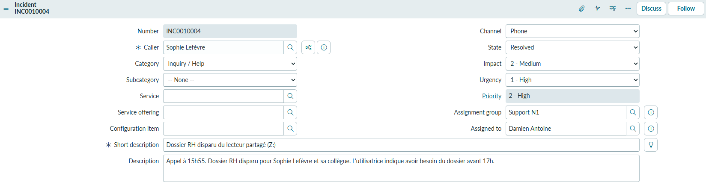
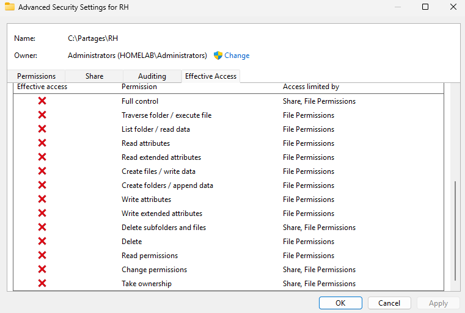
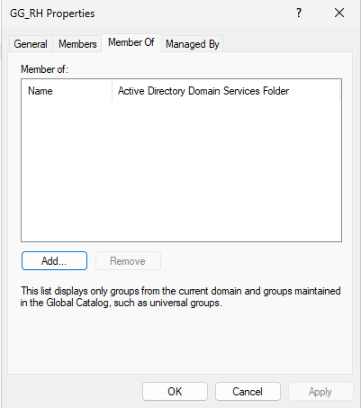
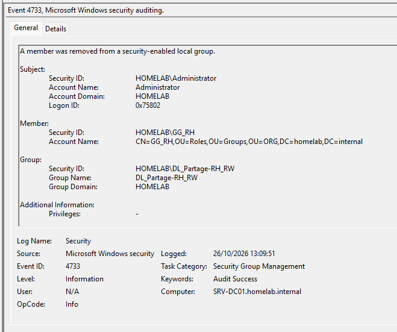
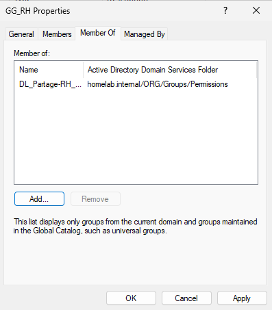
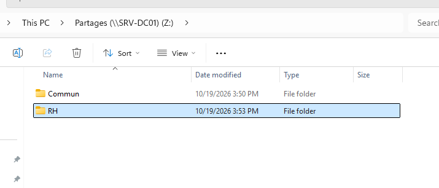
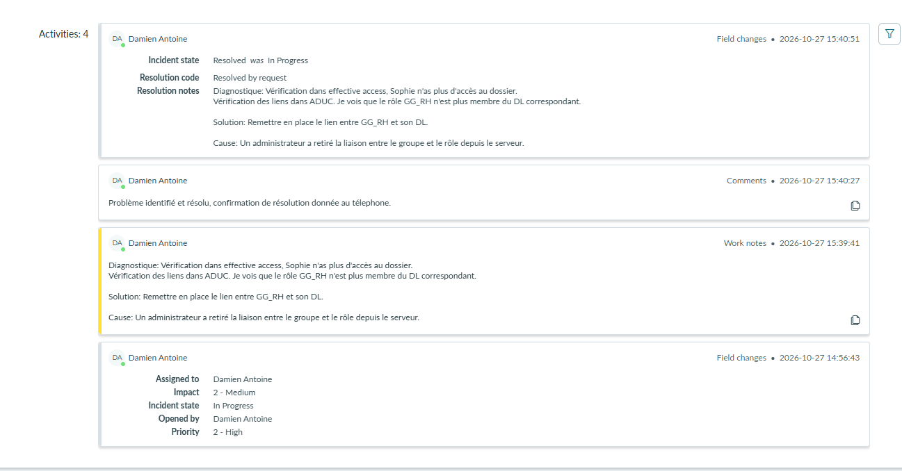

# TKT-010 — Dossier RH disparu du lecteur partagé

| Champ | Valeur |
| --- | --- |
| Type | Incident |
| Référence ServiceNow | INC0010004 |
| Demandeur | Sophie Lefèvre (RH) |
| Utilisateurs touchés | Service RH (Sophie Lefèvre et une collègue) |
| Canal | Téléphone |
| Date d'ouverture | 27/10/2026 |
| Date de résolution | 27/10/2026 |
| Priorité | 2 - High (impact moyen : tout un service ; urgence haute : éléments de paie à envoyer au cabinet comptable avant 17 h) |
| Statut | Résolu |

## Description
Le dossier RH n'apparaît plus dans le lecteur `Z:` : seul `Commun` est visible. Même constat pour une collègue du service. Le dossier était accessible le matin ; il a disparu après la pause déjeuner, au retour de session. Un redémarrage du poste n'a rien changé. Les fichiers de paie doivent être envoyés avant 17 h.

## Prise en charge
- Question de chronologie posée d'emblée : le dossier était accessible plus tôt dans la journée, et a disparu après une fermeture de session.
- Numéro de ticket communiqué pendant l'appel.
- Pas d'heure de résolution promise : engagement à rappeler dans 30 minutes pour un point, résolu ou non.
- Solution de secours écartée : copier les fichiers de paie sur une clé USB. Données personnelles sensibles, contournement du contrôle d'accès, et panne toujours présente pour le reste du service.

## Diagnostic
- **Effective Access** sur `C:\Partages\RH` pour `slefevre` : aucun droit, limité par les droits NTFS.
- **ADUC** : `GG_RH` n'est plus membre d'aucun groupe ; `DL_Partage-RH_RW`, seul groupe ayant les droits sur `RH`, est vide.

- **Recherche de l'origine** : événement **4733** (*A member was removed from a security-enabled local group*) sur SRV-DC01 :

| Champ | Valeur |
| --- | --- |
| Compte à l'origine | `HOMELAB\Administrator` |
| Membre retiré | `GG_RH` |
| Groupe | `DL_Partage-RH_RW` |
| Date | 26/10/2026 à 13:09:51 |

## Cause
`GG_RH` a été retiré du groupe de permission `DL_Partage-RH_RW` la veille à 13:09:51, avec le compte `Administrator`, sans demande de changement associée.

Le symptôme n'est apparu qu'à la reconnexion suivante des utilisatrices : une session ouverte conserve les groupes de son ouverture. C'est pourquoi le dossier restait accessible le matin et a disparu après la fermeture de session du midi. L'énumération basée sur l'accès masquant les dossiers sans droit de lecture, le dossier n'était pas « refusé » mais absent de `Z:`.

## Suivi

### 27/10/2026 — Résolution

**Actions :**
1. `GG_RH` remis dans `DL_Partage-RH_RW`.
2. Sophie Lefèvre réintégrée dans `GG_RH`, après un retrait pendant le diagnostic.
3. Rappel de la demandeuse dans le délai annoncé. Le dossier n'apparaît pas tout de suite : consigne donnée de fermer puis rouvrir la session, pour elle et sa collègue.

**Vérification :**
- Après reconnexion, `RH` réapparaît dans `Z:`, avec les fichiers. Confirmé par la demandeuse pour elle et sa collègue.

**Notes de résolution (ServiceNow) :**
> Diagnostique: Vérification dans effective access, Sophie n'as plus d'accès au dossier. Vérification des liens dans ADUC. Je vois que le rôle GG_RH n'est plus membre du DL correspondant.
> Solution: Remettre en place le lien entre GG_RH et son DL.
> Cause: Un administrateur a retiré la liaison entre le groupe et le rôle depuis le serveur.

**Statut :** Résolu

## Observation
Pendant le diagnostic, *Effective Access* a d'abord continué d'accorder l'accès à Sophie alors que `DL_Partage-RH_RW` était déjà vide ; l'affichage s'est corrigé de lui-même peu après. L'explication la plus probable est un cache : pour calculer les droits, le serveur obtient un ticket Kerberos au nom de l'utilisateur, qui contient ses groupes au moment de sa délivrance. Juste après une modification de groupe, *Effective Access* peut donc afficher des droits périmés : la vérification qui fait foi est une nouvelle session de l'utilisateur.

## Message de clôture
Confirmation donnée par téléphone. Message ajouté au ticket :
> Problème identifié et résolu, confirmation de résolution donnée au téléphone.

## Leçon retenue
- Première question d'un incident d'accès : **depuis quand**, et que s'est-il passé entre-temps ? Ici, une fermeture de session.
- Une modification de groupe se voit à la reconnexion suivante, parfois le lendemain : la cause peut être plus ancienne que le symptôme.
- Les événements 4733 (groupe domaine local), 4729 (groupe global) et 4757 (groupe universel) disent **qui** a retiré un membre, et **quand**.
- Le compte `Administrator` partagé identifie un compte, pas une personne : d'où l'intérêt des comptes d'administration nominatifs (`dantoine.adm`).
- La vraie cause est une modification des droits sans demande de changement : à signaler au responsable du support, et à éviter par une validation de toute modification des groupes de permission.
- Après une correction de groupe, la consigne « fermez puis rouvrez votre session » fait partie du message de résolution.
- À l'utilisateur, dire la cause réelle, simplement et sans désigner de responsable : « une modification des droits faite hier sur le serveur a retiré l'accès au service RH ; elle a été annulée, et l'incident est remonté pour éviter qu'il se reproduise ».
